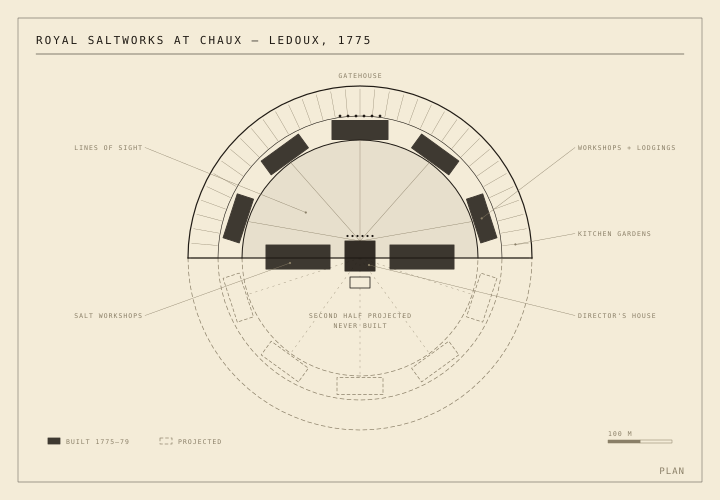

# Royal Saltworks at Chaux

<dl class="entry-meta">
<dt>Architect</dt><dd>Claude-Nicolas Ledoux (1736–1806)</dd>
<dt>Designed</dt><dd>1775 (half-circle); expanded to an ideal city plan c. 1804</dd>
<dt>Intended site</dt><dd>Arc-et-Senans, between the forests of Chaux and the town of Salins</dd>
<dt>Height / scale</dt><dd>Ideal city of approximately 2 km diameter; only the inner half-circle was built</dd>
<dt>Status</dt><dd>partially built — ideal city unrealised</dd>
</dl>

<figure>
  
  <figcaption>The built half-circle, with the Director's House at centre and workshops on the arc</figcaption>
</figure>

## What it was

In the 1770s the French Crown commissioned a new saltworks in Franche-Comté. The existing facility at Salins was running out of fuel — the forests around it had been felled to stoke its furnaces — and production needed to be moved closer to the still-wooded country around Arc-et-Senans, with the brine being piped across on a long aqueduct. Ledoux, royal architect, was given the design.

His built scheme is a half-circle. At the diameter, the Director's House stands on axis, an austere Palladian block. From the Director's House a colonnade faces outward, onto a gravelled court. Around the arc of the half-circle are eleven pavilions: workshops, crystallisation halls, and barracks for the workers. The walls are local stone, dressed in a stripped neoclassical vocabulary Ledoux made his own — plain ashlar, banded rustication, columns that look like they could be freshly quarried. The whole composition reads as a royal residence *for* industrial labour. Nothing in Europe looked like this in 1775.

This much was built between 1775 and 1779. It survives, on the UNESCO list, and can be visited.

What was not built is the rest. In the years after the Revolution Ledoux expanded the half-circle into a full ideal city — the Ideal City of Chaux — which he presented in engravings in 1804 in *L'Architecture considérée sous le rapport de l'art, des mœurs et de la législation*. The full plan extends the existing half-circle into a complete circle, and around the circle Ledoux arranged the social programme of an entire town: a Market Square, a Courthouse, a Cemetery (rendered as a hollow sphere — an echo of Boullée), a House of the Surveyor of the Loue River (rendered as a cylinder pierced by the river itself), and a House of Sexual Union (rendered as a phallic plan). Every building was a geometric figure whose form communicated its function. This is architecture parlante carried further than Boullée carried it: a city where you could navigate by the signature shape of each institution.

## Why it failed

The half-circle was built, and it ran. What stopped the larger scheme was the French Revolution. Ledoux was royal architect — he had designed the hated tax barriers of Paris, the *propylées* that ringed the city to collect the tax on goods entering it. In 1789 the barriers were his legal liability. He was imprisoned in 1793 and spent the Terror writing and drawing, narrowly escaping the guillotine. After his release he published the Ideal City of Chaux, fifteen years after the half-circle had been built and decades after the monarchy had ceased to commission anything. The ideal city was, by the time it was proposed, a proposal to a regime that no longer existed.

The saltworks themselves continued to operate until 1895, when the industry became uneconomic. The buildings fell into disuse, then into preservation. The phantom part of the project — the radial city around the half-circle — was never started.

## What-if

Chaux's built half remains the most complete early example of industrial buildings designed as architecture, rather than as sheds. If the full ideal city had been built, it would have been the first planned industrial community, fifty years before Robert Owen's New Lanark and seventy before Saltaire. It would also have been the most literal reading of architecture parlante ever constructed — a place where the buildings' forms named the buildings' functions without a word of signage.

The partial Chaux is eloquent in a way the complete Chaux could not have been. We have the built core, Palladian and austere, and around it the engraved plates of the unbuilt city — each building an idea, each idea rendered as a shape. The phantom half is easier to love than any realised ideal city has been.

---

**Next:** [Royal Palace at Westminster →](soane-royal-palace.md)
