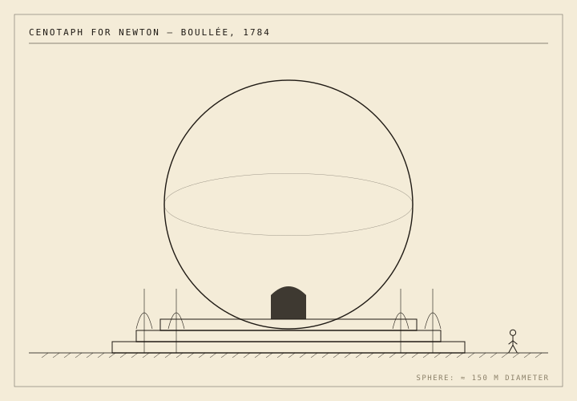

# Cenotaph for Newton

<dl class="entry-meta">
<dt>Architect</dt><dd>Étienne-Louis Boullée (1728–1799)</dd>
<dt>Designed</dt><dd>1784; plates preserved in the Bibliothèque nationale de France</dd>
<dt>Intended site</dt><dd>Paris; the cenotaph is notional, with no chosen lot</dd>
<dt>Height / scale</dt><dd>Hollow sphere of approximately 150 m diameter, set on a triple-stepped cylindrical base</dd>
<dt>Status</dt><dd>unbuilt — a thesis in drawing</dd>
</dl>

<figure>
  
  <figcaption>A hollow sphere on a triple-tiered base, cypress trees at the perimeter</figcaption>
</figure>

## What it was

Sir Isaac Newton died in 1727. In 1784, fifty-seven years later, a Parisian architect in his middle sixties sat down to design a tomb for him. Étienne-Louis Boullée had by this point all but stopped building. The school where he taught — the Académie royale d'architecture — had given him room to produce what he called "architecture parlante," speaking architecture, buildings whose form carried their meaning directly. The cenotaph for Newton is the most extreme of these.

The design is a hollow sphere of approximately 150 metres in diameter, sitting on a base of three low cylindrical tiers each planted with cypress trees. The entrance is a low arched portal in the base. A visitor entering the portal steps into the sphere's enormous interior. The sphere's inner surface is pierced with small apertures, which let in pinpoints of daylight. These pinpoints, against the blackness of the sphere's interior, resolve into the constellations of the night sky. The visitor stands at the centre of a perfect representation of the cosmos, at noon, in perpetual night. In the middle of the sphere, a small sarcophagus holds Newton's name.

Boullée described the intention directly: "O Newton! ... I conceived the idea of surrounding thee with thy discovery, and thus, somehow, surrounding thee with thyself." The sphere is a monument to the man by being a monument to the thing the man explained.

## Why it failed

The cenotaph was never meant to be built. Boullée presented it as a proposal in the same way that a later architect would present a competition board: it is a demonstration of principle. The sphere's structural problem is trivial — a 150-metre sphere of masonry cannot stand against its own weight, and even in reinforced concrete it would require engineering that Boullée's century had no access to. This was obvious to Boullée, and it was obvious to his contemporaries. The drawings were received at the Académie as a theoretical work.

What the cenotaph did do, more effectively than many built buildings, was *teach*. Boullée's plates circulated across Europe through engravings. The combined image of a vast primitive volume and a tiny human figure — the image that the engravings made inescapable — entered the architectural vocabulary and stayed. Every colossal twentieth-century monument, from the Palace of the Soviets to the Volkshalle to the Atomium, is working within terms Boullée established.

## What-if

If the cenotaph had been built, Paris would have a landmark in the lineage of the Panthéon and the Eiffel Tower — a structure whose silhouette would have dominated the city's skyline for generations. The interior experience — a reconstructed sky in permanent darkness, with Newton's sarcophagus at the centre — would have been something no other building delivered. It would have been visited the way the Hagia Sophia is visited: as an interior that changes you while you stand in it.

What the cenotaph actually did was more useful than what a built version could have done. By demonstrating that architecture could be about a single idea taken to an extreme, Boullée gave every architect after him permission to be extreme. The twentieth-century modernism that followed the Beaux-Arts — Le Corbusier, Wright, Mies — is unthinkable without the specific courage of Boullée's sphere. A phantom can teach more than a monument.

---

**Next:** [Royal Saltworks at Chaux →](chaux.md)
