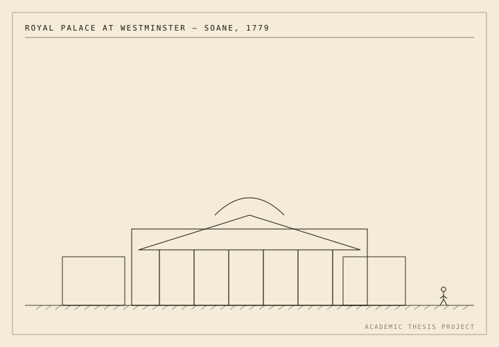

# Royal Palace at Westminster

<dl class="entry-meta">
<dt>Architect</dt><dd>John Soane (1753–1837)</dd>
<dt>Designed</dt><dd>1779; the Gold Medal thesis at the Royal Academy</dd>
<dt>Intended site</dt><dd>A notional site at Westminster, chosen to permit ceremonial siting along the Thames</dd>
<dt>Height / scale</dt><dd>Principal block with six-column portico, flanking wings, crowning dome; no specified overall dimensions, but scaled for a royal court</dd>
<dt>Status</dt><dd>unbuilt — student thesis</dd>
</dl>

<figure>
  
  <figcaption>Palladian main block with hexastyle portico, flanking wings, and low central dome</figcaption>
</figure>

## What it was

John Soane was twenty-five when he drew the Royal Palace. He had just finished his studies under George Dance the Younger, and was preparing for the Royal Academy Gold Medal — the student prize that funded the winner's travel to Italy. The programme for 1779 was a royal palace. Soane's scheme won.

His design is a Palladian composition at enormous scale. The principal block is a three-storey rectangular mass crowned by a low central dome and approached by a six-column portico in the Corinthian order. The portico carries a pediment containing an allegorical relief of Britannia receiving the homage of the arts and sciences. Wings extend on either side, each terminating in its own pedimented block, connected to the main mass by low colonnades. The whole composition reads across the Thames as a horizontal bar with a central dome, anchored by two symmetrical flankers. The plan provides for royal apartments on a piano nobile, state reception rooms, a throne room, a chapel, and the necessary household offices below.

Soane won the medal, took the Italian travel grant, and spent the next two years in Rome, Naples, and Sicily. When he returned to London he became one of the great architects of his century: the Bank of England, Sir John Soane's Museum at Lincoln's Inn Fields, Pitzhanger Manor, and a series of remarkable country houses. He did not design another royal palace, and no one commissioned one. The Westminster palace stayed in his drawers.

## Why it failed

There was no client for a royal palace in Westminster in 1779 or at any subsequent date. George III lived at Buckingham House (which was eventually rebuilt as Buckingham Palace, though not by Soane). His successors never required a second palace, and the budget for building one on the scale Soane proposed would not have survived a Commons vote. The design was, and remained, an academic exercise.

The Royal Academy thesis programmes of the late eighteenth century routinely produced projects of this kind — buildings too grand, too expensive, too politically unthinkable ever to build, drawn with the full rigour of a real commission. The students were being trained in composition, not in procurement. Soane's Palace is one of hundreds of such drawings produced across Europe in that half-century. Most of them are now lost. Soane's survives because he kept everything; his museum at Lincoln's Inn still holds the original sheets.

## What-if

A Westminster palace on this scale, had it been built, would have reorganised the south bank of the Thames. The axis of the river, today anchored by the Houses of Parliament (Barry, 1840–70), would instead have been anchored by Soane's dome and colonnades. The political geography of London would have been different: a monarch resident at Westminster rather than at Buckingham, with the Commons meeting in a less prepossessing hall.

The more interesting what-if is what Soane became *because* the palace was not built. Having failed to build a palace in his youth, he spent his career building the interiors of the Bank of England — the stock office, the consols office, the reduced rotunda — which are perhaps the most inventive interior spaces any English architect has produced. The Bank's later demolitions in the 1920s make the Bank nearly as phantom as the Palace. Soane, strangely, is an architect whose best work is half-gone and half-never-built.

---

**Next:** [Città Nuova →](../industrial/citta-nuova.md)
