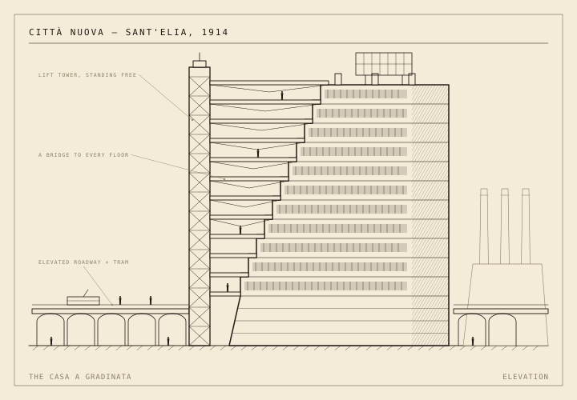

# Città Nuova

<dl class="entry-meta">
<dt>Architect</dt><dd>Antonio Sant'Elia (1888–1916)</dd>
<dt>Designed</dt><dd>1912–1914, exhibited as the Nuove Tendenze show, Milan, May 1914</dd>
<dt>Intended site</dt><dd>Milan, or any modern city; the scheme was generic</dd>
<dt>Height / scale</dt><dd>Multi-level setback towers; elevated and subterranean roadways; no fixed dimensions</dd>
<dt>Status</dt><dd>unbuilt — Sant'Elia killed at Monfalcone, 10 October 1916</dd>
</dl>

<figure>
  
  <figcaption>A setback industrial tower with external elevator shafts and an elevated roadway</figcaption>
</figure>

## What it was

Antonio Sant'Elia was twenty-five when he drew the Città Nuova. He had set up his own studio in Milan, was working on minor commissions for banks and apartment buildings, and was spending his evenings at the Caffè Cova with the circle of poets and painters that had coalesced around Filippo Marinetti's *Manifesto of Futurism* (1909). In 1914 Sant'Elia exhibited a group of drawings under the title *La Città Nuova* — The New City — at the Nuove Tendenze show in Milan. The drawings came with a manifesto, published in July 1914 and subsequently appropriated (over Sant'Elia's protest) as the Futurist Manifesto of Architecture.

The drawings describe a city organised around multi-level transport. Skyscrapers rise in vast stepped setbacks, the bases extending outward to meet elevated roadways at upper levels. External elevator shafts run diagonally up the exteriors of the towers. Subterranean railways run beneath the streets. Powerhouses, communications towers, and industrial buildings sit beside apartments and offices without any of the nineteenth-century separation between industrial and residential use. Materials are concrete, iron, glass. The ornament is the structure itself.

The manifesto text is worth quoting in one passage:

> We must invent and rebuild the futurist city like an immense and tumultuous shipyard, agile, mobile and dynamic in every detail; and the futurist house must be like a gigantic machine.

Nothing about this in 1914 was buildable at the scale proposed. Reinforced concrete existed, but not the vocabulary of curtain-wall high-rises that would make such a city feasible. The drawings are partly prophecy, partly propaganda.

## Why it failed

Sant'Elia died in the war. He volunteered for Italian service in 1915, served in the Lombard Volunteer Cyclist Battalion, and was killed in the battle of Monfalcone on 10 October 1916 at the age of twenty-eight. The Città Nuova existed at his death only as a body of drawings and a manifesto; he had built almost nothing. There was no successor to continue the project, though Futurism as a movement absorbed the drawings into its iconography.

A second reason the Città Nuova failed: it was generic. The drawings do not propose building a specific Futurist city on a specific site. They propose that *every* new building be of this kind. There was no commission to solicit, no client to approach. The proposal was for an entire built environment and could not have been started piecemeal.

## What-if

Sant'Elia's drawings are the visual template for every stepped, setback skyscraper city of the twentieth century. Hugh Ferriss, in New York in the 1920s, was drawing from the same toolkit (and probably, though Ferriss never acknowledged it, directly from Sant'Elia's plates). The 1916 New York zoning resolution, which mandated setbacks above specified heights, gave American skyscrapers a silhouette that looked remarkably like Sant'Elia's drawings. Gotham City, as envisioned by any comic-book artist or film director working from the 1930s onward, is Sant'Elia with gangsters.

What was never built was the full programme: the combined elevated road, subterranean rail, external elevator, and stepped tower, unified into one continuous infrastructural fabric. Pieces of it exist in Chicago's Wacker Drive, in Tokyo's elevated expressways, in the walkway systems of Hong Kong. Sant'Elia's integrated scheme, where every building participates in the transport network, remains undone. The interesting question is whether the undoneness is a failure or a mercy.

---

**Next:** [Hotel Attraction →](hotel-attraction.md)
