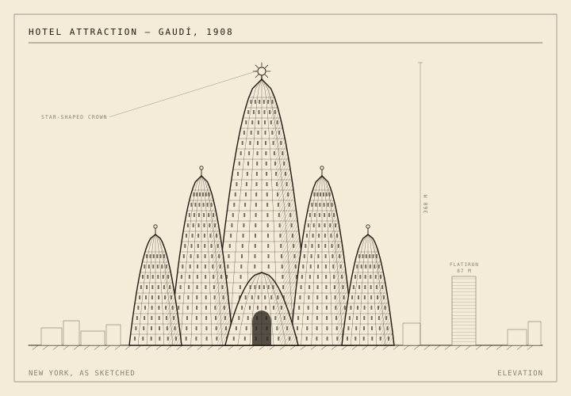

# Hotel Attraction

<dl class="entry-meta">
<dt>Architect</dt><dd>Antoni Gaudí (1852–1926)</dd>
<dt>Designed</dt><dd>1908, in Barcelona, from second-hand descriptions of the New York site</dd>
<dt>Intended site</dt><dd>Lower Manhattan, New York</dd>
<dt>Height / scale</dt><dd>360 m — considerably taller than anything in New York at the time (the Flatiron was 87 m)</dd>
<dt>Status</dt><dd>unbuilt — commission lapsed, designs largely lost to 1936 fire</dd>
</dl>

<figure>
  
  <figcaption>Parabolic bullet-form with projecting terraces and a parabolic crown</figcaption>
</figure>

## What it was

In the summer of 1908 two American investors visited Barcelona to see Antoni Gaudí about a commission. They wanted a hotel on Lower Manhattan that would be the tallest building in the world. They had chosen Gaudí because they had seen his Casa Milà going up, and they believed that a skyscraper in Gaudí's idiom would be the signature object Manhattan lacked.

Gaudí's design, worked out in Barcelona over the following year, was a parabolic tower 360 metres tall — more than four times the height of the Flatiron, and roughly fifty metres taller than the Eiffel Tower. The profile is a bullet: wide at the base, tapering in a continuous parabolic curve to a small rounded tip. Terraces project from the exterior at regular intervals, each cantilevered in Gaudí's signature Art Nouveau vocabulary. At the crown, five star-shaped spires cluster around a central spike, with the whole topped by an enormous observation sphere lit from within at night. The interior programme describes ballrooms, restaurants on every fifth floor, several hundred guest rooms, and an apartment for the owner at the very top.

The drawings were handled by a young architect in Gaudí's studio, Joan Matamala. The final set of plates, watercoloured and exhibited privately, showed the tower silhouetted against a schematic Lower Manhattan skyline. The building was the skyline, because the skyline of 1908 was almost nothing.

## Why it failed

The investors, Gaudí, and Matamala never met again after 1908. Gaudí's energy was, by that year, almost entirely absorbed by the Sagrada Família — the building that would occupy him until his death in 1926 and continue for a century thereafter. He was not in a position to travel to New York to supervise a project of that scale, and there is no evidence the American financing was ever confirmed. The commission quietly lapsed.

What happened to the drawings is its own melancholy story. A set of plates was held in Gaudí's studio at the Sagrada Família. In July 1936, at the start of the Spanish Civil War, anarchist militias broke into the Sagrada Família workshop and burned most of the contents — Gaudí's plaster models, his notebooks, his plans. The Hotel Attraction drawings were among the materials destroyed. What survives is a small set of Matamala's copies and reconstructions drawn in the 1950s from memory; these are the basis of all subsequent reproductions.

## What-if

A 360-metre Gaudí tower in 1908 Manhattan would have preceded the Woolworth Building (241 m, 1913), the Chrysler Building (319 m, 1930), and the Empire State Building (381 m, 1931). It would have arrived two decades before the skyscraper boom of the late 1920s, at a moment when the skyscraper typology was still being invented. Had the tower gone up as designed, the Manhattan skyline of the twentieth century would have been organised around a biomorphic Catalan landmark, and the rectilinear skyscraper aesthetic that came to define New York would have had to answer to that prior.

After the September 2001 attacks destroyed the World Trade Center, the Hotel Attraction was briefly revived as a proposal for Ground Zero by a group of Spanish and Catalan designers. The revival had no serious institutional backing and nothing came of it. Gaudí's tower remains where it has always been: on paper, copied from a lost original, imagined against a skyline that never received it.

---

**Next:** [Chicago Tribune Column →](tribune-column.md)
