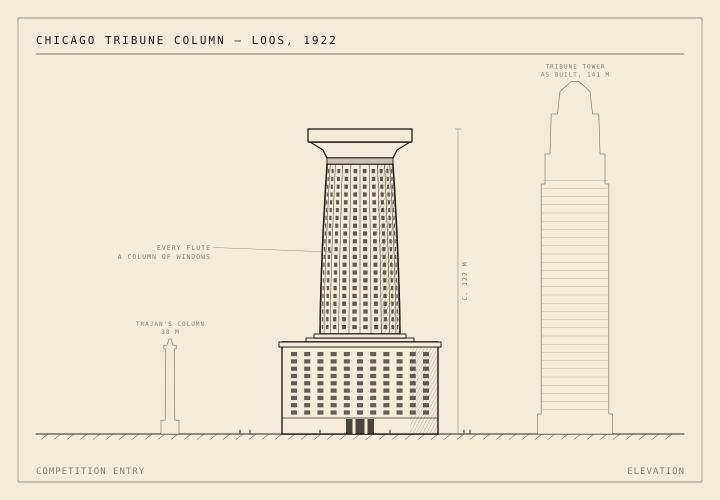

# Chicago Tribune Column

<dl class="entry-meta">
<dt>Architect</dt><dd>Adolf Loos (1870–1933)</dd>
<dt>Designed</dt><dd>1922, submitted to the Chicago Tribune Tower competition</dd>
<dt>Intended site</dt><dd>Michigan Avenue at the river, Chicago</dd>
<dt>Height / scale</dt><dd>Approximately 122 m — a single colossal Doric column on an office plinth</dd>
<dt>Status</dt><dd>unbuilt — competition won by Howells & Hood</dd>
</dl>

<figure>
  
  <figcaption>A plinth, a fluted Doric shaft, and a capital — the column as skyscraper</figcaption>
</figure>

## What it was

In 1922 the Chicago Tribune announced a competition to design "the most beautiful office building in the world" — its new headquarters, to be built on Michigan Avenue at the river. The prize was $50,000 and a commission. The competition drew 263 entries from across Europe and America. The winning entry, by John Mead Howells and Raymond Hood, was a Gothic Revival tower with flying buttresses at the crown; it was built, and it stands there today.

Adolf Loos, the Viennese architect who had argued in *Ornament and Crime* (1910) that ornament was a mark of cultural primitivism, submitted an entry that was itself an enormous ornament. His tower is a single Doric column. The plinth — eleven storeys of offices — is a black granite cube, banded by horizontal string-courses. The shaft of the column rises above the plinth, fluted, in white stone, at twenty-one storeys. The capital is a Doric abacus and echinus, executed at the scale of a three-storey building. There is no entasis; Loos draws the shaft as a pure cylinder.

The total height is approximately 122 metres, which would have made the column the seventh-tallest building in the world at the time. The programme of the building is shoehorned into the cylindrical shaft — elevators at the core, offices pinwheeling around them, the square plan abandoned above the plinth in favour of circular floor plates.

Loos's argument was that a commercial newspaper, which traded in the quotidian, should be housed in a building whose form was the single best-known piece of architectural iconography on the planet. A Doric column says "classical, serious, institutional" without saying a word. The building was, in this sense, the ultimate piece of architectural branding.

## Why it failed

The jury placed Loos's entry well down the list. It was too literal, too visibly a joke against the competition's own pretensions. The Tribune wanted a monument that said *newspaper*, not a monument that said *look at this paradox about ornament*. Loos's entry arrived from Vienna when the winning entries were being reviewed and was recorded as having received no serious consideration by the judges.

The larger reason the column failed is that nobody else wanted one either. In the years after 1922 a number of architects (Loos himself, half-jokingly; a few American architects, rather earnestly) played with the idea of a classical-order skyscraper. The idea never produced a building. By the late 1920s Art Deco had supplied the American skyscraper with its preferred vocabulary — stepped setbacks, ornament integrated with structure — and the free-standing column as a skyscraper became unambiguously historical.

## What-if

If the column had been built, Chicago would have a piece of architectural thinking at its riverfront that no other American city has. The column would have been seen two ways simultaneously: as a literal monument to Western civilisation, and as Loos's sly demonstration that a single ornament at sufficient scale *becomes* the building. Contemporary architecture's preoccupation with icons — Frank Gehry's Guggenheim Bilbao, Herzog & de Meuron's stadiums, Norman Foster's Gherkin — is a weaker and later version of the argument Loos was making in one drawing in 1922.

What did get built at the Tribune site is the Gothic Revival tower by Howells and Hood, with flying buttresses modelled on the Butter Tower of Rouen Cathedral. It is a handsome and thoroughly literal building. The other entry that almost won, and almost changed American architecture, was Eliel Saarinen's — a stepped modernist tower whose silhouette went on to shape every skyscraper built in Manhattan during the late 1920s. Saarinen's entry was a phantom twice over: unbuilt, and widely imitated.

---

**Next:** [Monument to the Third International →](../revolution/tatlin.md)
