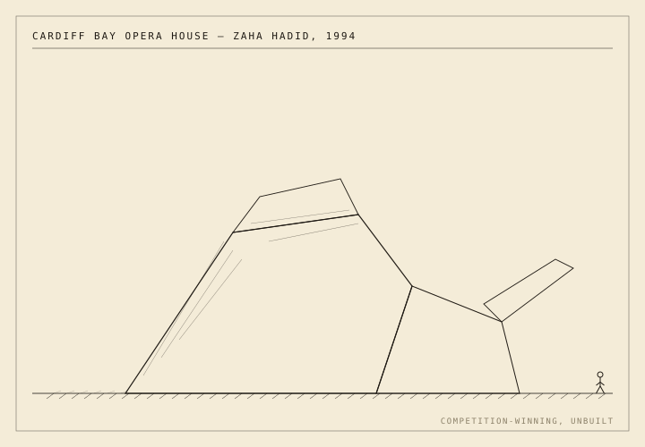

# Cardiff Bay Opera House

<dl class="entry-meta">
<dt>Architect</dt><dd>Zaha Hadid (1950–2016)</dd>
<dt>Designed</dt><dd>1994 — won the Cardiff Bay Opera House Trust international competition, beating 269 entries</dd>
<dt>Intended site</dt><dd>Cardiff Bay, Wales — a regeneration zone on the waterfront</dd>
<dt>Height / scale</dt><dd>1,900-seat opera house with supporting chamber hall, foyers, and rehearsal rooms; total approximately 25,000 m²</dd>
<dt>Status</dt><dd>unbuilt — Millennium Commission refused Lottery funding</dd>
</dl>

<figure>
  
  <figcaption>Collision of tilted prismatic volumes and a sharply cantilevered fin</figcaption>
</figure>

## What it was

In 1994 the Cardiff Bay Opera House Trust ran an international competition for a new opera house on the redeveloped Cardiff waterfront. The project had political weight. Wales had campaigned for its own national opera house for decades; the Millennium Commission — the body distributing UK National Lottery funds for major cultural projects — had indicated it would consider Cardiff Bay Opera as a flagship Millennium project. The competition attracted 269 entries from around the world. The jury, chaired by the Welsh architect Norman Foster's former partner, awarded first prize to Zaha Hadid.

Hadid's scheme is a collision of sharp angular volumes. The main opera hall — a prismatic volume — leans into a second prism containing the chamber hall and the rehearsal rooms. A sharply cantilevered fin projects over the bay. The foyers wrap around the halls at ground level in a series of tilted planes that open toward the water. The whole composition has no right angles on the exterior; every surface is tilted. The building reads, from across the bay, as a crystalline intrusion into the waterfront — something that has just landed there, still settling.

The interior planning solved the opera-house problems soundly: a 1,900-seat main auditorium with a full fly-tower, a 400-seat chamber hall for recitals, rehearsal rooms sized for the Welsh National Opera and the BBC National Orchestra of Wales, and the sequence of foyers, bars, and terraces that a major cultural building needs. Hadid's engineering partners on the scheme were Ove Arup. The project was technically, programmatically, and logistically coherent.

## Why it failed

The Millennium Commission refused to fund it. The official reason given was that the project was insufficiently commercial — the hall's seat count and programming plan, the Commission held, were not robust enough to pay back the operating subsidy. The unofficial reasons were many: Hadid's design was regarded by some Welsh political figures as too foreign, too radical, insufficiently Welsh; she was a woman; she was Iraqi; she had built almost nothing at the time (the Vitra Fire Station in Germany, 1993, was her first completed building). The tabloid press ran campaigns against the scheme. A competing proposal for a rugby stadium on the site — the Millennium Stadium — was funded instead, and was built.

The rejection was a public and humiliating one for Hadid. She later described it as the worst professional setback of her career. It was also not the only time: in 1996 she won a competition to design the Victoria and Albert Museum Boilerhouse extension in London, and that project also failed to find funding and was abandoned. The Cardiff rejection is emblematic of a specific moment in the mid-1990s in which Hadid's drawings were celebrated in the architectural press but her buildings were not being commissioned. She did not complete a second built building until 1998.

## What-if

A built Cardiff Bay Opera House would have been one of the first major cultural buildings of the Deconstructivist movement, completed before Gehry's Guggenheim Bilbao (1997). Cardiff, not Bilbao, would have been the first example of the "Bilbao effect" — the regeneration of a declining industrial city by a single spectacular building. The prominence of Hadid as an architect, and the pace of her subsequent commissions, would have accelerated by several years. Her built œuvre — which grew to include the MAXXI in Rome, the Heydar Aliyev Centre in Baku, the London Aquatics Centre, and the Guangzhou Opera House — would have been bracketed on the front end by Cardiff.

What actually happened was almost as influential. Hadid's drawings for the competition, her paintings and her constructions on paper, circulated in the architectural press for years. They taught a generation of architects that competition boards could be as consequential as built buildings. Hadid won Cardiff, lost the funding, and became better known internationally than the winners of many built competitions of the same period. By 2004 she was the first woman to win the Pritzker Prize. By her death in 2016 her practice was global and her built work was everywhere. The Cardiff Opera became, in retrospect, a kind of credential: the building she *would* have built, had she been allowed to. After its cancellation, the cancellations and near-cancellations of other projects became easier for her, and then easier still for every architect who came after, to resist. The phantom opera house helped train the institutions that later commissioned the built ones.

---

**Next:** [Crystal Island, Moscow →](crystal-island.md)
