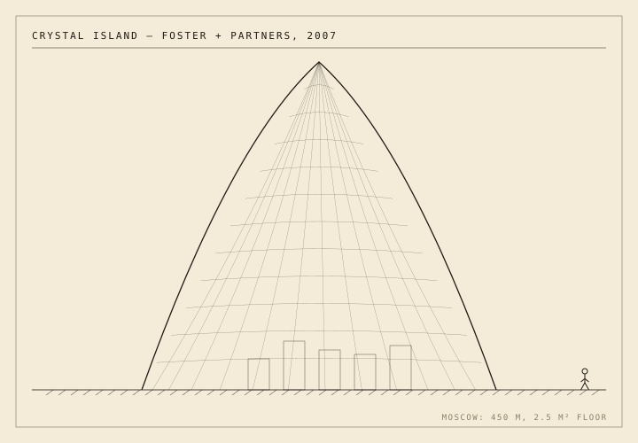

# Crystal Island

<dl class="entry-meta">
<dt>Architect</dt><dd>Foster + Partners (Norman Foster), London</dd>
<dt>Designed</dt><dd>2007; presented at MIPIM Cannes, March 2008</dd>
<dt>Intended site</dt><dd>Nagatinskaya Poyma, Moscow — a flood plain bend in the Moskva River, south of the city centre</dd>
<dt>Height / scale</dt><dd>450 m tall; 2,500,000 m² floor area — the largest single building ever proposed</dd>
<dt>Status</dt><dd>unbuilt — construction halted by 2008 financial crisis, never resumed</dd>
</dl>

<figure>
  
  <figcaption>A tented glass envelope enclosing apartments, offices, schools, and an international school</figcaption>
</figure>

## What it was

Crystal Island was commissioned in 2007 by Shalva Chigirinsky, a Russian real-estate developer with close ties to the Moscow city administration. Foster's brief was to design a single building capable of housing a substantial satellite city on a flood-plain site at a bend in the Moskva River, nine kilometres south of central Moscow.

The resulting building is an enormous tented enclosure. A conical envelope of glass and steel rises from a roughly circular base to a single peak 450 metres above ground. Inside the envelope, supported on a secondary structure of trusses and shear walls, rises a conventional city: 900 apartments, 3,000 hotel rooms, 300,000 square metres of commercial and retail space, an international school, a sports centre, a theatre, and fourteen thousand parking spaces. The total enclosed floor area is 2,500,000 square metres — about four times the Pentagon and the largest single building ever seriously proposed. Foster's own studio estimated that the project, if built, would house approximately 30,000 people and employ another 27,000.

The outer envelope does two things. First, it creates a climate-controlled internal city — Moscow's climate is brutal in both directions, and an enclosed building allows a constant interior temperature. Second, it gives the complex a single architectural identity. From across the river it reads as one peak — a Russian Mont Saint-Michel — rather than as a cluster of buildings. The skin is gridded with panels of variable opacity, which can open or close according to the season; in summer the south-facing panels shade the interior, in winter they open to admit solar gain.

## Why it failed

Groundbreaking on Crystal Island took place in March 2008. Construction began on the foundation pit. Then the global financial crisis arrived in September 2008. Chigirinsky's company, Russian Land, lost access to capital. The Moscow city administration — under Mayor Yuri Luzhkov, who had approved the project — came under political pressure to halt the scheme. Luzhkov was dismissed by Russian President Dmitry Medvedev in 2010 on a corruption investigation. The project's planning permissions were revoked in the aftermath. The site was cleared and left empty; the foundation pit was filled in.

Chigirinsky himself fled Russia in 2009 under threat of prosecution. Russian Land entered insolvency. No successor developer picked up Crystal Island, and by 2015 the proposal was formally dead. The site at Nagatinskaya Poyma remained undeveloped until 2020, when a theme park — "Dream Island," Moscow's largest — opened on approximately the same ground. The new building is a functioning attraction with Disney-styled architecture and a fraction of the floor area Foster had proposed.

## What-if

A built Crystal Island would have been, by a substantial margin, the largest single building on the planet. It would have tested the question of whether a mixed-use interior city under a single envelope could operate as a coherent community, or would have fragmented into clusters of unrelated uses sharing a skin. The engineering was achievable; Foster had previously built the Millau Viaduct and the Reichstag dome, and his office had developed the expertise to manage the structural and environmental systems at this scale.

What Crystal Island shares with many of the late phantoms in this catalog is a dependence on speculative capital. Tatlin's tower required a revolution; Speer's Volkshalle required a victorious war; Wright's Illinois required a client who never arrived. Crystal Island required the mid-2000s Russian construction boom to continue. When that boom stopped in September 2008, the building stopped with it. The building was feasible; the economic conditions that had made it feasible evaporated, and did not return.

This is the characteristic mode of twenty-first-century phantom architecture. Unlike the earlier phantoms — which failed for political or ideological reasons, or because the material science was not yet available — Crystal Island failed because the money disappeared. The same is true of many other 2000s-era megaprojects: Santiago Calatrava's Chicago Spire (2007, halted 2008), the original Dubai Palm Deira (2002, halted 2008), Rem Koolhaas's RAK Gateway (2008, halted 2010). The financial crisis produced a whole generation of phantoms. Crystal Island is the largest of them.

---

[← Back to the catalog](../index.md)
