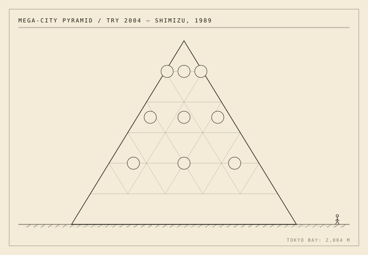

# Mega-City Pyramid / TRY 2004

<dl class="entry-meta">
<dt>Architect</dt><dd>Shimizu Corporation Research and Development Institute</dd>
<dt>Designed</dt><dd>1989, as the TRY 2004 concept study</dd>
<dt>Intended site</dt><dd>Tokyo Bay — a 12 km × 12 km footprint in the open water</dd>
<dt>Height / scale</dt><dd>2,004 m tall (the project name); approximately 750,000 residents; 204 stacked modular cities</dd>
<dt>Status</dt><dd>unbuilt — material science has not yet caught up</dd>
</dl>

<figure>
  
  <figcaption>Tetrahedral truss holding spherical city modules at nodes</figcaption>
</figure>

## What it was

In 1989, at the height of Japan's asset-price bubble, Shimizu Corporation — one of Japan's four largest general contractors — published a concept study for the largest man-made structure ever proposed. The project was called TRY 2004, named for its intended height in metres. It is often referred to simply as the Mega-City Pyramid.

The structure is a tetrahedral truss 2,004 metres tall, resting on twelve kilometres of footprint in Tokyo Bay. The truss is not a solid pyramid; it is a spaceframe — a regular lattice of tetrahedral cells, each node reinforced, the whole assembled from carbon-nanotube struts. Inside the lattice, at selected nodes, hang spherical "sky-cities" — each a self-contained residential, commercial, and agricultural community for approximately 3,750 people. Two hundred and four sky-cities hang within the lattice, for a total population of roughly 750,000.

The sky-cities are connected to each other by an internal transport network: high-speed lifts and personal-rapid-transit pods running along the truss members. Each sky-city has its own microclimate; the interior of the lattice has its own weather, managed by the shape of the outer skin. Solar, wave, and wind generation supply power. Fresh water is gathered from rain and condensation on the outer surface. The pyramid was designed, in Shimizu's presentation, as a response to Japan's expected late-twenty-first-century population pressure and the unsuitability of low-lying coastal Japan for denser development in an era of rising seas.

The programme was prepared as a detailed feasibility study. Shimizu's engineers specified structural loads, material requirements, construction sequences, and cost estimates in 1989 yen. The cost was approximately ¥80 trillion, then roughly US $720 billion.

## Why it failed

The material science does not yet exist. The structural truss required — 2 km high, self-supporting against wind loading, spanning between nodes of several hundred metres — can be analysed in finite-element simulations, and the simulations indicate that no steel or reinforced-concrete construction can do the job. The study's engineers specified carbon-nanotube-reinforced composites as the structural member. Carbon nanotubes were discovered in 1991, two years after the study was published; structural-grade nanotube materials at industrial volumes did not exist then and still do not. Shimizu's scheme was a bet on a material that had not yet been invented.

The economic environment also failed to cooperate. 1989 was the last year of the Japanese asset bubble; by 1991 the bubble had deflated, and Japan entered the two-decade stagnation known as the Lost Decades. Large speculative construction proposals from 1989 Japan — TRY 2004, the X-Seed 4000 tower, the Sky City 1000 — all went onto the shelf. Shimizu has revisited TRY 2004 periodically since, most recently in 2012, but always as a future-possibilities study rather than as an active project.

## What-if

A built TRY 2004 would solve a specific problem — how to house three-quarters of a million people on effectively no land — that most coastal cities will eventually need to solve. Its engineering would be unprecedented. The carbon-nanotube lattice, if made to work, would be the material breakthrough of the century. The internal organisation of 204 self-contained sky-cities, each with its own microclimate and its own governance, would be an experiment in stacked urbanism at a scale never previously attempted.

The more honest thing to say about the Mega-City Pyramid is that it is a test of what a society will pay for future-proofing. Japan in 1989 was the wealthiest society in history on a per-capita basis, and its largest contractor proposed the pyramid as a plausible sixty-year undertaking. Japan since 1989 has had neither the will nor the material sciences to revisit the plan seriously. If climate-driven coastal pressure continues to accelerate, some coastal city somewhere will eventually be forced to consider pyramid-scale solutions. Whether the structure they build resembles TRY 2004, or something entirely different, is a question whose answer is still being drafted.

For now, the pyramid remains a drawing in Shimizu's research library, annotated with materials specifications for a substance that nature has not yet allowed us to fabricate at scale. It is a phantom of the most precise kind: a building waiting on one specific technological door to open.

---

**Next:** [Cardiff Bay Opera House →](cardiff-opera.md)
