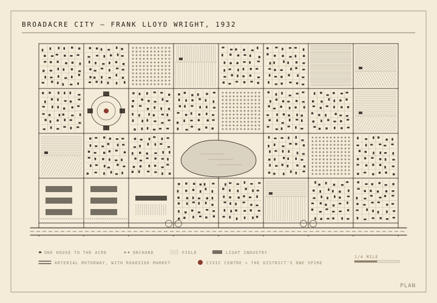

# Broadacre City

<dl class="entry-meta">
<dt>Architect</dt><dd>Frank Lloyd Wright (1867–1959)</dd>
<dt>Designed</dt><dd>1932, refined continuously until Wright's death; large model built by apprentices at Taliesin, 1934–1935</dd>
<dt>Intended site</dt><dd>Anywhere with usable land — the scheme is generic and non-geographical</dd>
<dt>Height / scale</dt><dd>One acre per family; one-mile square neighbourhood units; one vertical spire per district</dd>
<dt>Status</dt><dd>unbuilt — a 4-square-mile model toured the US, 1935</dd>
</dl>

<figure>
  
  <figcaption>Distributed single-family units on individual acres; one civic spire per district</figcaption>
</figure>

## What it was

Broadacre City is Frank Lloyd Wright's answer to Le Corbusier's Plan Voisin, drawn at almost the same time and arguing the exact opposite. Where Le Corbusier wanted to concentrate the population in eighteen towers, Wright wanted to spread it out across the landscape — one acre of land per family, homes arranged not in streets but in large loose lots, connected by a grid of highways that treated the land between homes as productive acreage.

Wright first presented Broadacre in his 1932 book *The Disappearing City* and elaborated it in a lecture series at Princeton that year. The scheme took physical form in 1934–1935 when Wright's apprentices at Taliesin built a 3.6-metre-square model depicting four square miles of Broadacre at 1:75 scale. The model showed:

- Single-family Usonian houses, each on an acre of ground, each with a car and a kitchen garden.
- Light industry distributed among the homes rather than concentrated — factories small enough to be walked to, or driven to in minutes.
- Civic buildings — schools, libraries, a single tall office tower per administrative district — placed at road junctions.
- Agricultural land interleaved with residential and industrial. The boundary between "city" and "farm" was deliberately dissolved.
- A highway grid, a rail line, and aerodromes for the small personal aircraft Wright expected everyone to eventually own.

The model toured the United States in 1935, with stops in Pittsburgh, Washington, and Madison. Wright presented it as a fully-worked planning scheme. The press coverage was respectful. No city adopted it.

## Why it failed

Broadacre failed because no one ever has the authority to execute it. The scheme required distributing land — one acre per family — across a region of several hundred square miles. That required eminent domain at a scale only a nation-state could exercise, and political will such a state almost never had. Even the Tennessee Valley Authority, the great experiment in regional planning from the same decade, did not reorganise land ownership on a Broadacre basis.

What happened instead was that Broadacre was built without anyone deciding to build it. Post-war American suburbanisation produced, in aggregate, a landscape strongly resembling Wright's scheme: low-density single-family homes on half-acre lots, connected by a highway grid, with industrial and commercial functions distributed among residential neighbourhoods. The outcome differed from Broadacre in two specific ways. First, the landscape was developed privately, piece by piece, rather than as a coordinated plan — so there are fewer of the civic amenities Wright drew (the schools, the arts centres, the libraries) and more of the private amenities the market provided (shopping malls, gas stations). Second, the land grants were nominal: a suburban lot is typically an eighth of an acre, not a full acre, and the productive agriculture Wright envisioned never happened.

## What-if

A full Broadacre America would have looked like the suburbs we actually got, with additional civic infrastructure and actual agricultural yield from the distributed acreage. It would have required the federal government to act as a planner on a scale it has never acted. The more interesting counterfactual is whether Wright was right about the underlying premise — that the automobile and the telephone made the dense industrial city obsolete, and that America's future belonged to a distributed, small-town, technologically modern rural landscape.

The automobile and the telephone did produce the distributed settlement pattern Wright predicted. What they did not produce was the civic thickness Wright thought would accompany it. A Broadacre township, in Wright's drawings, has a library, a hospital, a school, a philharmonic hall, and a research laboratory, each within a few minutes' drive. A suburb of Atlanta in 2026 has a shopping centre, a megachurch, a Chick-fil-A, and a tenth of each of the institutions Wright drew. The geography came true. The culture did not. Broadacre remains phantom even where, geographically, it was executed.

---

**Next:** [The Illinois / Mile-High →](mile-high.md)
