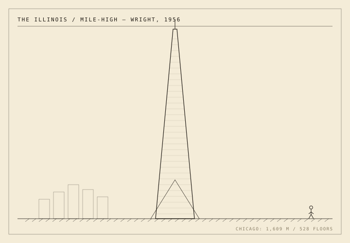

# The Illinois / Mile-High

<dl class="entry-meta">
<dt>Architect</dt><dd>Frank Lloyd Wright (1867–1959)</dd>
<dt>Designed</dt><dd>1956, presented 16 October 1956 at the Sherman Hotel, Chicago</dd>
<dt>Intended site</dt><dd>Chicago lakefront, unspecified lot</dd>
<dt>Height / scale</dt><dd>1,609 m (one mile); 528 storeys; 100,000 occupants; atomic-powered elevators</dd>
<dt>Status</dt><dd>unbuilt — Wright was 89; no client; no commission</dd>
</dl>

<figure>
  
  <figcaption>A tripod-braced needle rising from a cluster of conventional skyscrapers</figcaption>
</figure>

## What it was

On 16 October 1956, Frank Lloyd Wright — then 89 years old — unveiled at a Chicago press conference a project for a 1,609-metre skyscraper. He called it *The Illinois*. The press and subsequent history have mostly called it Mile-High.

The building is a single triangular needle, tapering continuously from a base of approximately 120 metres to a slim tip at the summit. The tripod base is braced by three massive legs, which Wright intended to be executed in steel and reinforced concrete. The interior was to be organised as 528 storeys. Lifts — atomic-powered, according to Wright's announcement, though no such lift had ever been engineered — would run at speeds of up to sixty miles per hour in "quintuple-deck" banks. The building would hold 100,000 occupants and 15,000 parked cars, with helicopter landings at the upper levels.

Wright's schematic rendering, prepared with his office, shows the Illinois rising from a cluster of Chicago skyscrapers — the Palmolive Building, the Wrigley, the Tribune Tower, the Merchandise Mart — each rendered at approximately one-tenth of the Illinois's height. The drawing makes clear what the tower is for: it is a dare. It says that the Chicago skyline of 1956, tall as it is, is provincial; that a real skyscraper should dwarf everything around it; and that it is possible, with enough will, to build such a thing now.

Wright had no client. He announced the project without a commission, without a site, and without a declared source of financing. The press release was the project.

## Why it failed

No one commissioned it, no one funded it, and Wright died two and a half years after the announcement, on 9 April 1959, without the project having progressed beyond its initial drawings. There is no evidence he expected the Illinois to be built. The announcement was a provocation, a statement of principle, a demonstration that the skyscraper could be taken further than anyone had taken it.

Several specific objections made it infeasible in 1956. The tripod base's lateral bracing was possible but expensive. Lift technology in 1956 topped out at speeds that would have made the upper 400 storeys of the building functionally unreachable — a trip to the top would have taken well over an hour, during which time the elevator would have been the tallest structure actively in use. The "atomic-powered" lifts Wright mentioned were fictional; no atomic elevator system has ever been built. The wind loading at a mile of altitude would have required a base foundation of unprecedented size and depth.

Modern engineering — post-2010 — can build a mile-high building. The Jeddah Tower, under intermittent construction in Saudi Arabia since 2013, is designed to exceed a kilometre and has targeted a mile. The engineering problems Wright waved at are solvable. The economic question — whether there is enough demand for office space at a mile in altitude to pay back the construction — is a separate question, and it has not yet been answered with a completed building anywhere on earth.

## What-if

Had the Illinois been built, Chicago's skyline would have had a single landmark dominating every other building by a factor of four. The Willis Tower (1974, 442 m), itself briefly the world's tallest, would have been a short afterthought. The architectural conversation of the late twentieth century — whether the skyscraper could continue rising, whether the tall building had a natural limit — would have been a different conversation, because Wright would have resolved it with a built example.

The more interesting thing Wright did with the Illinois was to demonstrate that a single building could, as an object, be a complete statement about what was possible. The Illinois is what a late-career Wright considered his summation: not a house, not a museum, not a church, but a tower so tall that it became a question mark over the idea of cities. Every subsequent architect designing an ultra-tall tower — Foster's Millennium Tower in Tokyo, Koolhaas's unbuilt plans for Jakarta, the Kingdom Tower and its successors — has been answering Wright's question. The Illinois taught the discipline to think at mile-scale. It did this without ever leaving the page.

---

**Next:** [Palace of the Soviets →](../power/palace-of-soviets.md)
