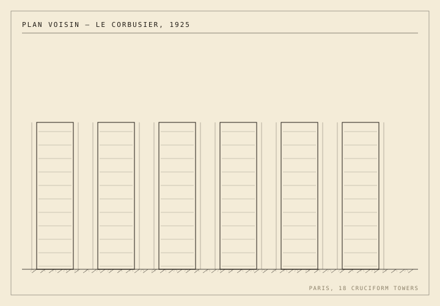

# Plan Voisin

<dl class="entry-meta">
<dt>Architect</dt><dd>Le Corbusier (Charles-Édouard Jeanneret, 1887–1965)</dd>
<dt>Designed</dt><dd>1925, presented at the Exposition internationale des Arts Décoratifs, Paris</dd>
<dt>Intended site</dt><dd>Three square kilometres of central Paris, north of the Seine, between the Gare de l'Est and the Louvre</dd>
<dt>Height / scale</dt><dd>Eighteen identical 200-metre cruciform-plan towers, spaced 400 m apart, on a uniform orthogonal grid of elevated highways</dd>
<dt>Status</dt><dd>unbuilt — proposal rejected by municipal authorities</dd>
</dl>

<figure>
  
  <figcaption>Eighteen identical cruciform towers; the plan shows six in elevation for clarity</figcaption>
</figure>

## What it was

Plan Voisin was Le Corbusier's proposal to demolish three square kilometres of central Paris — the Marais, parts of the 1st, 3rd, and 4th arrondissements, the streets around the Rue de Rivoli north of the Louvre — and replace them with eighteen identical 200-metre skyscrapers on a regular grid of elevated highways. The scheme was named for Voisin, the aviation and automobile manufacturer that had funded its publication at the 1925 Paris decorative-arts exposition. Voisin's money bought the pavilion in which the plan was displayed.

The towers are cruciform in plan — a plus-sign footprint — spaced 400 metres apart on an orthogonal grid. Between the towers, the ground is a park. Above the park, at the second-storey level, runs a grid of elevated highways with pedestrian decks below and vehicle traffic above. Most of historic central Paris is gone. The Louvre, the Tuileries, the Place Vendôme, the Palais Royal, and a handful of other designated historic buildings remain — preserved as monuments in what is otherwise a tabula rasa.

Le Corbusier described the scheme in *Urbanisme* (1925) with the specific conviction that the historic Paris was unworkable: its streets too narrow for motor traffic, its buildings too dark and crowded, its populations too concentrated at street level. The answer was to move the population up into towers with light, air, and park views; to move the traffic onto elevated corridors; and to free the ground level for parkland.

The plan was exhibited as a large model and as a set of axonometric drawings. The model showed the eighteen towers in precise regularity, each identical, standing over a park crossed by straight highways.

## Why it failed

Paris refused. Le Corbusier's proposal received public attention and some sympathetic reviews, but no municipal authority seriously entertained demolishing the Marais. The combined cost, displacement, and cultural objection was prohibitive. By the mid-1930s Le Corbusier himself had moderated the scheme in favour of more incremental planning proposals (the Ville Radieuse, 1930, applied similar principles to less historically sensitive sites).

What the plan did was educate an entire generation of urbanists in the doctrine of the tower-in-the-park. Housing projects across Europe and America built between 1945 and 1975 — London's Trellick Tower, Paris's own post-war social housing estates, New York's Stuyvesant Town, Chicago's Cabrini-Green, the Pruitt-Igoe estate in St Louis — implemented pieces of Le Corbusier's prescription on cleared or new ground. The social outcomes were mixed. Pruitt-Igoe was demolished in 1972; Cabrini-Green followed. The tower-in-the-park typology, applied in full, produced environments that the residents reliably abandoned when they had the means to.

## What-if

If Paris had accepted Plan Voisin, the Marais would be gone. So would the Palais Royal, the narrow streets behind Les Halles, the bookshop-studded alleys around the Place des Vosges. Eighteen identical skyscrapers would stand over a cleared landscape, visible from every point in Paris and almost indistinguishable from each other. The tourist trade that sustains Paris's economy would have developed around different artefacts — the preserved Louvre and Notre Dame — while the city's fine grain would have been replaced by a geometry best appreciated from the air.

What actually happened was that Paris preserved itself with particular ferocity. The Malraux Law of 1962 established protected sectors for historic quarters; the Marais is one of them. The city built its Plan-Voisin-scale tower concentration not at the centre, but at La Défense, five kilometres west of the Louvre, outside the Boulevard Périphérique and out of sight of anyone standing on the Champs-Élysées. Le Corbusier's towers did arrive in Paris, but as Paris's suburbs rather than its centre. That is the version of the plan that survived: towers at the edge, preserved historic core at the middle. It is a compromise the city is now, after fifty years, mostly comfortable with.

---

**Next:** [Broadacre City →](broadacre.md)
