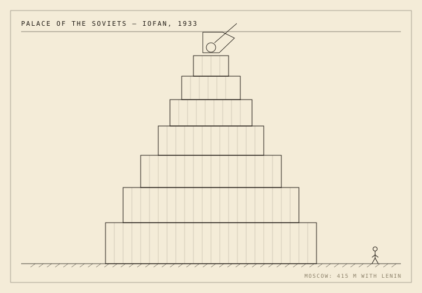

# Palace of the Soviets

<dl class="entry-meta">
<dt>Architect</dt><dd>Boris Iofan (1891–1976), with Vladimir Shchuko and Vladimir Gelfreikh</dd>
<dt>Designed</dt><dd>1933 (competition); final scheme approved 1934; construction begun 1937</dd>
<dt>Intended site</dt><dd>Volkhonka Street, Moscow — the site cleared by the 1931 demolition of the Cathedral of Christ the Saviour</dd>
<dt>Height / scale</dt><dd>415 m total, including a 100 m statue of Lenin; 100,000 m² main hall; stepped tiered base</dd>
<dt>Status</dt><dd>partially built — foundations; steel frame to 7 storeys; dismantled for war effort 1941–42</dd>
</dl>

<figure>
  
  <figcaption>Tiered stepped base with a colossal Lenin at the summit — a finger of granite, raised</figcaption>
</figure>

## What it was

The Palace of the Soviets was to be the central building of the Soviet Union — its parliament, its principal assembly hall, its ceremonial space. The original competition was announced in 1931 and drew entries from around the world, including Le Corbusier (whose entry, a modernist scheme with vast parabolic vaults, reached the final round and was rejected). In 1933 a committee settled on Boris Iofan's scheme, which was reworked through several iterations until 1934, when the final form was approved.

The final scheme is a tiered stepped base — seven concentric tiers, each smaller than the one below, ascending through 300 metres — topped by a 100-metre-tall statue of Lenin. The total height is 415 metres. Lenin stands with one arm raised, roughly over the site where the cathedral used to be; his index finger alone is to be longer than a bus. The building is sited on a cleared square along Volkhonka Street, a few blocks from the Kremlin, on land previously occupied by the Cathedral of Christ the Saviour. Stalin ordered the cathedral dynamited in December 1931 to clear the site.

Internally, the Palace was to contain a Great Hall seating 21,000 for congresses of the Communist Party; a Lesser Hall seating 6,000; libraries; exhibition spaces; a monumental staircase; and the offices of the Supreme Soviet. The architecture is a heavy stripped classicism, columns and pilasters rendered at enormous scale without ornament, more sculptural than tectonic. The whole tiered volume is the base for the statue.

## Why it failed

Construction began in 1937. Foundations were excavated — a ring of concrete 140 metres in diameter, sunk into Moscow's waterlogged soil. Steel was fabricated and the lower frame of the stepped base was erected to a height of approximately seven storeys. Photographs from 1938 and 1939 show a ring of black steel rising over the Moscow river.

Then the war came. In 1941, with the German army advancing on Moscow, Soviet engineers dismantled the steel frame of the Palace and used the material for anti-tank defences and for the wartime reconstruction of bridges and rail lines. What remained was the foundation — a submerged concrete ring. The construction never resumed.

After the war, Stalin's architectural priorities shifted. The Seven Sisters (Moscow's seven Stalinist skyscrapers, built 1947–1953) satisfied the regime's need for monumental high-rises without the burden of the Lenin statue or the 415-metre total height. The Palace site sat as an abandoned foundation into the 1950s. In 1958 Khrushchev authorised its conversion into an open-air heated swimming pool — the Moskva Pool — which operated on the foundations until 1994. After the fall of the USSR, the cathedral that had stood on the site before 1931 was rebuilt to the original plans; it was consecrated in 2000 and stands there now.

## What-if

A completed Palace of the Soviets would have been the tallest building in the world upon completion, and would have held the record until the World Trade Center (1972). It would have set the model for every totalitarian-monument tower of the twentieth century: the plinth-as-base, the figure-as-apex, the architecture as a pedestal for ideology. Some of that model was built anyway — Speer's Volkshalle was designed in the same years, and Iofan's influence on Axis monumental architecture is documented. But the specific image of Lenin-as-skyscraper would have dominated Moscow's skyline in a way no other single image would have.

The site's history is its own strange phantom chain. Cathedral — dynamited. Palace — foundations only, then swimming pool. Pool — drained, demolished. Cathedral — rebuilt to the 1883 drawings. The current building is the 1883 cathedral executed in 1996–2000, occupying the space that was cleared for Iofan in 1931. The Palace of the Soviets is the void around which all the other buildings have circulated.

---

**Next:** [Volkshalle, Germania →](volkshalle.md)
