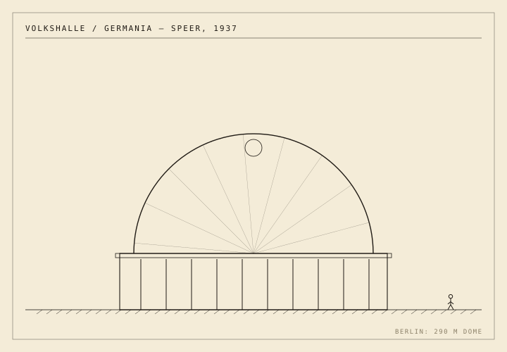

# Volkshalle, Germania

<dl class="entry-meta">
<dt>Architect</dt><dd>Albert Speer (1905–1981), to Adolf Hitler's specifications</dd>
<dt>Designed</dt><dd>1937–1940; site preparation begun 1939, construction paused indefinitely 1943</dd>
<dt>Intended site</dt><dd>North end of the Great Axis, Welthauptstadt Germania (the planned redevelopment of Berlin)</dd>
<dt>Height / scale</dt><dd>290 m total; 250 m internal dome diameter; capacity 180,000 standing</dd>
<dt>Status</dt><dd>unbuilt — regime destroyed before foundations could be laid</dd>
</dl>

<figure>
  
  <figcaption>A drum of columns beneath a 250-metre interior dome — the largest enclosed space ever proposed</figcaption>
</figure>

## What it was

Hitler's plan for post-war Berlin, formalised after 1937, was to transform the city into "Welthauptstadt Germania" — the World Capital Germania. The plan was drawn by Albert Speer at Hitler's direct instruction. Its centrepiece was a vast north-south boulevard, seven kilometres long, running from a new southern rail terminal to a new northern government quarter. At the north end of this axis, facing the Reichstag (which was to be retained as a library), would stand the Volkshalle — the People's Hall.

The Volkshalle is a domed assembly building. The drum supporting the dome is 290 metres tall and 320 metres in diameter. Around the drum runs a colonnade of sixteen stone columns, each approximately 70 metres tall. The dome itself has an internal diameter of 250 metres — larger than St Peter's (42 m), larger than the Pantheon (44 m), larger than any enclosed space built or proposed in human history. A small oculus at the crown admits light. The interior is a single volume of 21 million cubic metres, intended to hold 180,000 standing spectators for Party rallies addressed by Hitler from a central speaker's platform.

The building is clad in granite quarried from concentration-camp labour in Mauthausen and Flossenbürg. Speer's drawings are explicit about the intended atmosphere: the dome should be so tall that the upper portion is perpetually lost in mist formed by the breath of the assembled crowd. Hitler wanted the Volkshalle to dwarf every earlier monument — the Pantheon, St Peter's, the US Capitol — by the simple expedient of being larger. It is a phantom built to assert through size alone the legitimacy of a regime.

Site preparation for the axis began in 1939. Streets were widened, buildings demolished, a vast swampy marsh at the Volkshalle's proposed site was tested for load-bearing. The column for the Volkshalle's test footing — the *Schwerbelastungskörper*, a massive cylindrical concrete block — was cast in 1941 to calibrate the sinking of the Berlin subsoil. It still stands in the Tempelhof district.

## Why it failed

Germany lost the war. Speer's designs for Germania — including the Volkshalle, the triumphal arch, and the Great Hall — depended on victory in 1940 or soon after. When the war continued, resources were redirected. Construction on Germania was paused in 1943 and never resumed. Speer himself was imprisoned at Nuremberg from 1946 to 1966. By 1945 Berlin was a ruin; by 1947 the city was divided; by 1961 the wall ran through what would have been Speer's southern rail terminal.

There was also a structural objection to the Volkshalle that Speer himself quietly recognised. A 250-metre unsupported dome is on the edge of what reinforced concrete could achieve in 1940 — perhaps possible, perhaps not. The test footing was cast precisely because Speer's engineers were unsure the Berlin soil could carry the load. The answer, when the footing was measured in the 1940s, was that the soil could not. The Volkshalle's dome was at the limit of the materials and the foundations that existed to support it.

## What-if

A completed Volkshalle would have been the signature building of a victorious Third Reich. It would have stood for as long as the regime stood, which in the best case for Hitler was probably a few decades. In the actual case, the regime ended in 1945, so the Volkshalle's tenure would have been short. What would have persisted is the precedent: a building whose function was explicitly to be large, to impress by scale alone, to reduce the individual citizen to a standing figure of insignificance beneath an engineered sky.

That precedent persists anyway. The North Korean Ryugyong Hotel (330 m, construction halted 1992) is a descendant. So is the Palace of the Parliament in Bucharest (completed 1997), the second-largest administrative building in the world, commissioned by Ceaușescu in the same spirit. The architecture of authoritarianism has a remarkably consistent palette: granite cladding, stripped classicism, interior spaces at superhuman scale. The Volkshalle was not built, but its syntax was exported — and built.

The granite that was quarried for the Volkshalle survives. Some of it was used after the war for Soviet war memorials in East Berlin, including the Treptower Park memorial. Hitler's granite became, by war's accident, the monument to the soldiers who brought the regime down. The stones outlasted the building that was going to be made of them.

---

**Next:** [Dome over Manhattan →](../utopias/dome-over-manhattan.md)
