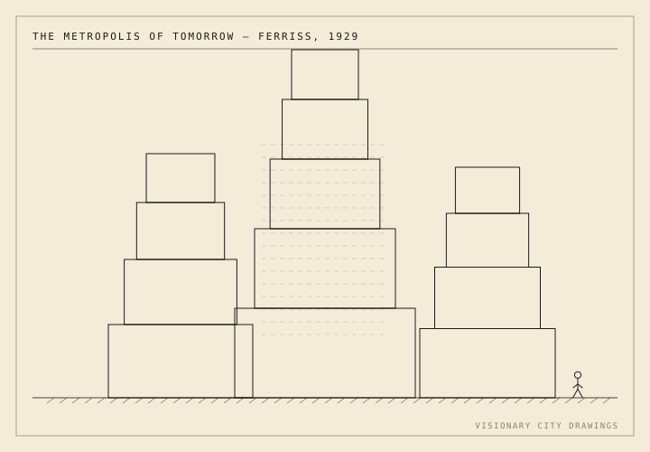

# The Metropolis of Tomorrow

<dl class="entry-meta">
<dt>Architect</dt><dd>Hugh Ferriss (1889–1962)</dd>
<dt>Drawn</dt><dd>1922–1929, published 1929 as *The Metropolis of Tomorrow*</dd>
<dt>Intended site</dt><dd>A generic American city — no named location</dd>
<dt>Height / scale</dt><dd>Towers rendered at heights of 300–1,000 m; the book's "Business Zone" tower stands to 1,000 feet (approximately 305 m)</dd>
<dt>Status</dt><dd>unbuilt — the drawings are the city</dd>
</dl>

<figure>
  
  <figcaption>Stepped setback skyscrapers rendered at colossal scale</figcaption>
</figure>

## What it was

Hugh Ferriss was not, strictly, an architect. He was a renderer — the man whom New York architects of the 1920s hired to produce the charcoal perspective drawings that sold their buildings to clients and to the public. He drew the Shelton Hotel, the Barclay-Vesey Telephone Building, the RCA Building. He drew in charcoal on brown paper, in the low-contrast style that saw a skyscraper as a mountain rising out of permanent dusk. The style became definitive of American cities in the 1920s.

In 1929, at the height of his career, Ferriss published *The Metropolis of Tomorrow* — a book of his own imagined drawings. The book has three parts. The first reprints his technical drawings for the 1916 New York Zoning Resolution, which established the mandatory setback envelope that shaped every American skyscraper for the next fifty years. The second shows the architects' own drawings for specific Manhattan buildings, reproduced in Ferriss's charcoal technique. The third is Ferriss's own vision: "An Imaginary Metropolis."

The imaginary city is organised by zones. A Business Zone occupies the centre: vast stepped towers, each essentially the 1916 Zoning envelope taken to its maximum, crowded together without streets visible between them, their setbacks cut at different heights so that the city above street level looks like a mountain range. An Art Zone contains philharmonic halls, libraries, a planetarium — rendered as lower, broader buildings with ceremonial approaches. A Science Zone has laboratories resembling cathedrals. Between the zones, elevated roadways on pylons carry traffic at the mid-heights of the buildings, connecting at specific junctions. Aircraft land on the roofs.

Ferriss's drawings are rendered. They are not technical plans. They are composed like landscape paintings, in chiaroscuro, with the details softened by atmosphere. The effect is to present the city as something one cannot quite see — too big, too hazy, too mountainous to be grasped whole.

## Why it failed

It was never submitted anywhere. Ferriss's drawings were an author's project, published as a book, priced at $7.50 in 1929. The book sold, was widely reviewed, and went into a second printing. It never proposed that any specific city be built according to the drawings. There was no client, no commission, no legal vehicle. The Metropolis of Tomorrow was speculative architecture in the strict sense: it was a book.

What happened instead was imitation. Every film director, comic-book artist, and advertising illustrator who needed to render "the city of the future" between 1929 and 1960 drew from Ferriss. The opening sequences of *King Kong*, *Metropolis* (in its American publicity), *Things to Come*, and *Batman: The Animated Series* all descend from the book. The charcoal-mountain aesthetic — the setback tower rising out of cloud — became the default visual language of the future. Fifty years later, Ferriss's silhouettes are the first thing a concept artist draws when asked to sketch an American metropolis.

## What-if

Had American cities been built to Ferriss's plates — had any specific city adopted the three-zone scheme with elevated roadways — the result would have been a more extreme version of what Chicago and Manhattan became anyway. The 1916 zoning setbacks gave American skyscrapers their stepped silhouette; Ferriss's drawings pushed that silhouette to its maximum. A Ferrissian Manhattan would have had taller, more widely-spaced towers, connected by mid-air roads, and with most of the ground level abandoned to service traffic. Something like that was built, in pieces, across the American megacities of the twentieth century. It is what every highway-borne approach to downtown Chicago, Dallas, or Los Angeles is trying to be.

The more interesting thing Ferriss produced is the aesthetic. The drawings proved that the *rendering* could be the work. For a phantom building, the drawing is not a sketch for something else — it is the whole output. Every competition board produced in the decades since has been trying to achieve what Ferriss did in *The Metropolis of Tomorrow*: to make a drawing that is more persuasive than any photograph of a real building would be.

---

**Next:** [Plan Voisin →](../modernism/plan-voisin.md)
