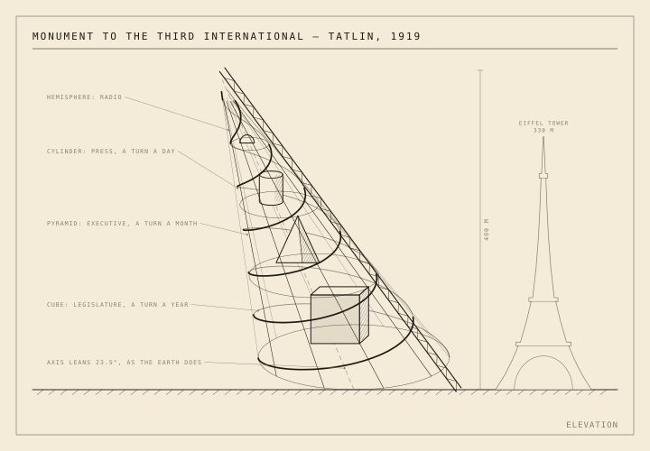

# Monument to the Third International

<dl class="entry-meta">
<dt>Architect</dt><dd>Vladimir Tatlin (1885–1953)</dd>
<dt>Designed</dt><dd>1919–1920; wooden model exhibited in Petrograd, December 1920</dd>
<dt>Intended site</dt><dd>Petrograd (Leningrad)</dd>
<dt>Height / scale</dt><dd>400 m (proposed); would have been the tallest structure in the world, taller than the Eiffel Tower</dd>
<dt>Status</dt><dd>unbuilt — three interior volumes each intended to rotate at its own period</dd>
</dl>

<figure>
  
  <figcaption>A leaning double helix enclosing three rotating volumes — cube, pyramid, cylinder</figcaption>
</figure>

## What it was

In 1919 the Department of Fine Arts of the People's Commissariat for Enlightenment commissioned Vladimir Tatlin to design a monument to the Third International — the Comintern, the new coordinating body for world communist parties, founded earlier that year. Tatlin was given no site, no budget, and no engineering staff. He was given the subject.

His design, worked up in his Petrograd studio over 1919 and 1920, is unlike any building before or since. Two interlocking helical steel frameworks, leaning at sixty degrees, twist upward around a common axis. Inside the lattice hang three enclosed volumes in primary geometries: at the bottom, a cube; in the middle, a pyramid; at the top, a cylinder. Above the cylinder, Tatlin added a hemisphere — the "radio station" — from which, in the drawings, broadcast waves radiate.

The three volumes were to rotate. The cube, which housed the legislative assembly of the Comintern, turned once a year. The pyramid, which housed the executive committee, turned once a month. The cylinder, which housed the information bureau and propaganda organs, turned once a day. The hemisphere at the top, which broadcast news across the world, turned once an hour. The entire building was a functioning clock — a building whose structure embodied the periodicity of its institutions.

Tatlin's wooden model, built at a 1:25 scale by his students, was exhibited in Petrograd in December 1920. Lunacharsky, the People's Commissar for Enlightenment, came to see it. Photographs of the model circulated internationally — in Germany, in France, in New York — through the early 1920s.

## Why it failed

The Soviet Union in 1920 could not build a 400-metre steel tower. The civil war had destroyed much of Russian industry; steel was scarce; engineers with high-rise experience did not exist in the new state; and the country was not in a position to pay for such a project even when it recovered. By 1924 Lenin was dead, and the official Soviet taste — soon to be imposed as doctrine — had shifted away from Constructivist experiment toward the neoclassical socialist realism that produced the Palace of the Soviets a decade later. Tatlin was increasingly out of step. He spent the 1930s working on a glider, *Letatlin*, trying to give the common man the power of flight. He died in Moscow in 1953, largely forgotten; his rehabilitation into the Soviet canon came only during the Khrushchev thaw.

There is a second question about the design itself: whether the rotating volumes could have been engineered. A cube with an annual rotation rate is trivially possible; a pyramid with a monthly rotation rate is trivially possible; what is harder is structure. The leaning double-helix framework would have required steel fabrication at tolerances the USSR of 1920 had no way of achieving. A full-size version attempted today with modern engineering would be expensive but possible. A full-size version in 1920 Petrograd was technically out of reach.

## What-if

Tatlin's tower is the most influential unbuilt building of the twentieth century. Every later architect who has designed a monument that *moved* — that rotated, that shifted, that played a mechanical role as well as a symbolic one — is descended from it. Every architect who has made the structural exoskeleton into the primary figure of a building — from Buckminster Fuller through Richard Rogers to Santiago Calatrava — is descended from it. The tower did more work as a drawing, and as a photograph of a model, than most built buildings do in a century.

The plate of the leaning double helix, published and republished, became a visual shorthand for the entire early Soviet experiment. After 1989, when Communism ended and its architecture was left either demolished or stranded, Tatlin's tower remained — now free of its ideological origins, pure form again. A replica was finally built, at 1:20 scale, for the 2011 Royal Academy exhibition *Building the Revolution*. It stood in the courtyard of Burlington House for three months. It was the first time Tatlin's tower had been in the same city as a London audience. It was ten metres tall. It was the wrong size. It was the right shape.

---

**Next:** [The Metropolis of Tomorrow →](ferriss.md)
