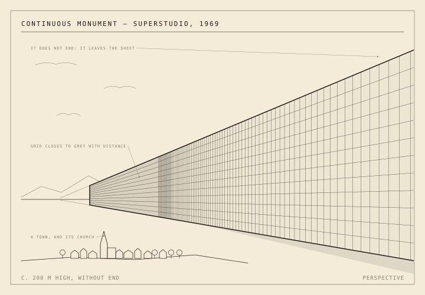

# Continuous Monument

<dl class="entry-meta">
<dt>Architect</dt><dd>Superstudio (Adolfo Natalini, Cristiano Toraldo di Francia, and collaborators), Florence</dd>
<dt>Drawn</dt><dd>1969–1971, published as a series of photomontages and texts</dd>
<dt>Intended site</dt><dd>Superstudio's drawings place the monument across New York, the Alps, the Sahara, the Grand Canyon, Mont Blanc, and much of the rest of the world</dd>
<dt>Height / scale</dt><dd>A single gridded bar of approximately 200 m height, extending indefinitely</dd>
<dt>Status</dt><dd>unbuilt — explicitly a critique</dd>
</dl>

<figure>
  
  <figcaption>A gridded monolithic bar extending past the edge of the drawing</figcaption>
</figure>

## What it was

In 1969 the Florentine architectural collective Superstudio began producing a series of photomontages under the title *Il Monumento Continuo*. The montages show a featureless gridded bar — approximately 200 metres tall, its surface a uniform lattice of identical square panels — extending across the landscapes of the world. In one montage it rides along the skyline of Manhattan, eclipsing the existing skyscrapers. In another it crosses the Arizona desert, rising out of the sand. In another it cuts across the Alps like a geological rift. In another it runs through the Grand Canyon. In another it loops the planet, and the montage shows it from orbit.

Superstudio produced the drawings as part of their larger project of "critical architecture" — architecture conceived as commentary rather than as commission. The Continuous Monument was not a proposal. It was an image: a demonstration of what an architecture of total homogeneity would look like, applied to the whole planet, and a dare to the reader to find something to object to in it.

The dare is sophisticated. Each element of the Continuous Monument is, individually, unobjectionable. The grid is regular. The proportions are harmonious. The material is presumably durable. The scale is ambitious but not preposterous. What becomes horrifying is the cumulative effect: the whole landscape subsumed by a single architectural language, the whole planet reshaped to a single building. The monument is not any specific tyranny. It is the tyranny of applied reason when reason is insufficiently humble about what it does not know.

Superstudio's text accompanying the montages was explicit:

> The history of design has always been the history of tyranny. Now we propose its final triumph: the tyranny that no longer needs a tyrant.

## Why it failed

The Continuous Monument was never meant to be built. It was meant to be absorbed as an image. Superstudio's work participates in a specific late-1960s moment — the same moment that produced the Situationist détournement, Italian *arte povera*, and the student protests of 1968 — in which critique through fiction was valued over proposal through design. The Continuous Monument is a photomontage, a piece of visual polemic, an argument against modernism conducted in the visual language of modernism.

Could it have been built? At 200 metres tall, extending indefinitely, the Monument would require engineering and materials at planetary scale. The dimensioning is deliberately at the boundary of the impossible — large enough that the viewer can see how it would look, impossible enough that the viewer knows the image is not a proposal. Had Superstudio drawn something smaller, it would have read as feasible and been engaged as an engineering problem; at the scale they chose, the image reads as an argument.

## What-if

The Continuous Monument is the closing argument of modernism's universal project. Every modernist proposal before it — Plan Voisin, Broadacre, Tatlin, even Ferriss — had assumed that a single architectural language, applied to the world, would be desirable. Superstudio took the hypothesis seriously and followed it to its conclusion. The conclusion was: it would look like this, and it would be terrifying.

After the Continuous Monument, modernism could no longer assert its universality innocently. The next architectural generation — postmodernism, the contextualism of Colin Rowe, the regionalist turn in the late 1970s — defined itself partly against what Superstudio had shown. If modernism's premise really was a global grid, then architects had to choose: either commit to the grid with open eyes, or step back from the premise. Most architects chose the second. Critical regionalism, which became the dominant international discourse of the 1980s, is Superstudio's argument received.

The specific visual influence is diffuse. Every dystopian megastructure in cinema, from *Logan's Run* to *Blade Runner* to *Dune*, carries something of the Continuous Monument. So do the actual megastructures that have been built: the Shanghai World Financial Center, Dubai's linear developments, the Three Gorges Dam. None of these is the Continuous Monument, but each of them has a Continuous Monument inside it. What Superstudio did was provide the argument that makes those buildings legible as a single species.

---

**Next:** [Mega-City Pyramid →](../late/mega-city-pyramid.md)
