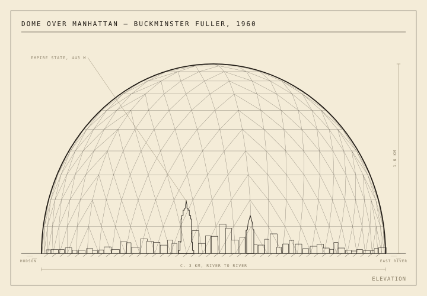

# Dome over Manhattan

<dl class="entry-meta">
<dt>Architect</dt><dd>R. Buckminster Fuller (1895–1983), with Shoji Sadao</dd>
<dt>Proposed</dt><dd>1960, as a feasibility study and published advocacy piece</dd>
<dt>Intended site</dt><dd>Midtown Manhattan, centred roughly on the Empire State Building</dd>
<dt>Height / scale</dt><dd>Approximately 3 km diameter; 1.6 km high at apex; geodesic aluminium frame</dd>
<dt>Status</dt><dd>unbuilt — speculative</dd>
</dl>

<figure>
  
  <figcaption>A geodesic hemispherical shell over a section of Midtown</figcaption>
</figure>

## What it was

Buckminster Fuller's Dome over Manhattan was a proposal to enclose a two-mile-diameter section of Midtown — from roughly 22nd Street to 65th Street, from the East River to the Hudson — under a single geodesic dome approximately 3,000 metres across and 1,600 metres tall at the crown. Inside the dome, the city would continue to function as usual: the Empire State Building, Grand Central, Rockefeller Center, Times Square — all of it would remain, and all of it would be under glass.

The proposition was a thought experiment about energy. Fuller had been developing geodesic domes through the 1950s — the Montreal Biosphere (1967) would be a late realised example — and he had been calculating energy balances for enclosed environments. His argument for Manhattan was that the energy cost of heating and cooling the buildings in the covered area, across a sufficient number of winters, would exceed the energy cost of a single geodesic enclosure that kept the interior at a constant temperature. The dome paid back its construction cost in fuel savings within twenty years. After twenty years, the dome was making money.

Fuller's drawing, produced with his partner Shoji Sadao, shows the dome as a geodesic lattice of thin aluminium struts, glazed with clear panels, sitting over the existing skyline. The skyline would be unchanged; only the weather would be different. Snow would not fall inside; rain would not fall; the temperature would be at 20° Celsius year round.

## Why it failed

The dome was never proposed to a specific client. Fuller published it as part of his advocacy for geodesic structures and as a way of dramatising the energy argument. No municipal body, private consortium, or federal agency ever received a serious proposal to build it. The capital cost — estimated by Fuller at around $200 million in 1960 dollars, probably an order of magnitude too low — would have required a political and financial coalition that no one assembled.

The structural engineering, by Fuller's lights, was within reach. A 3-kilometre geodesic dome is larger than any geodesic that has been built, but the principle scales: as the sphere grows, the ratio of surface weight to enclosed volume decreases, so a large geodesic is relatively lighter per unit volume than a small one. Fuller's claim — that the dome would be "lighter than the air it contained" — was at least dimensionally plausible.

What would have prevented the dome in practice was the specific question of how the boundary works. What happens at street level where the dome meets Manhattan? How do ships reach the riverside piers? How does the subway vent? How do aircraft overfly the city? These questions had answers in principle — airlock entrances, vented louvres, overflight corridors — but each answer was its own project. The simplicity of Fuller's drawing concealed the programmatic complexity of making the dome actually land on a functioning city.

## What-if

A domed Manhattan would have been, by some distance, the largest enclosed environment in human history. It would have consumed enormous resources to build. It would also have produced a Manhattan that was effectively weatherless, which would have changed the character of the city in ways Fuller did not entirely anticipate. The snow that whitens Fifth Avenue; the rain that cleans the streets; the sunset that reddens the East Side at the end of summer — all of those phenomena would be outside, and the city inside would be under perpetually flat light.

The dome-over-a-city idea has been rebuilt in small form many times. The Mall of America is effectively a micro-dome. Eden Project in Cornwall is a medium-dome habitat. The covered mall, the covered office atrium, the enclosed arena — all are partial Fullerian answers to the energy argument. What has never been attempted is the full-city version, and given the scale of modern climate control, it is unlikely ever to be attempted in the form Fuller drew.

Fuller's drawing is, like Ferriss's charcoals, more useful as a piece of argumentation than it would have been as a building. It asks the viewer to compute, in their head, the energy budget of heating ten thousand separate buildings versus one very large one. Every time somebody makes that comparison, the dome has done its work.

---

**Next:** [Tokyo Bay Plan →](tokyo-bay.md)
