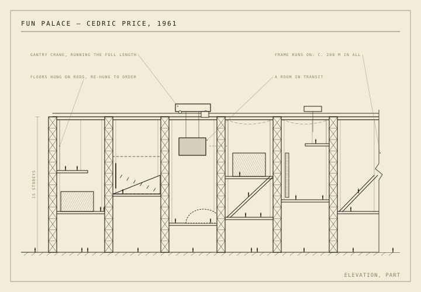

# Fun Palace

<dl class="entry-meta">
<dt>Architect</dt><dd>Cedric Price (1934–2003), with theatre director Joan Littlewood; cybernetics by Gordon Pask</dd>
<dt>Designed</dt><dd>1961–1965; site secured at Lea Valley; planning permission refused 1966</dd>
<dt>Intended site</dt><dd>Mill Meads, Stratford, East London (the site that later became the Olympic Park)</dd>
<dt>Height / scale</dt><dd>Approximately 200 m × 80 m frame; 15-storey tall; programme fitted within by crane-moved modules</dd>
<dt>Status</dt><dd>unbuilt — planning permission denied, 1966</dd>
</dl>

<figure>
  
  <figcaption>A fixed steel gantry with movable activity modules suspended and cranes above</figcaption>
</figure>

## What it was

The Fun Palace began as a conversation between the theatre director Joan Littlewood and the young architect Cedric Price in 1961. Littlewood had been running the Theatre Royal Stratford East, staging experimental working-class theatre, and wanted something that could extend what theatre did — a building where audiences were not audiences but participants, where programmes were not scheduled weeks in advance but reconfigured within the week or within the day, where learning, play, and performance happened side by side.

Price's architectural answer was a fixed steel gantry approximately 200 metres long, 80 metres wide, and fifteen storeys tall. The gantry itself was permanent. Everything inside was movable. Rooms, stages, workshops, classrooms, cinemas, and cafes were built as prefabricated modules. Gantry cranes running along the top of the frame moved modules into place, removed them, reconfigured them. A theatre that operated yesterday as a 500-seat proscenium might be reconfigured overnight into three separate workshops, a café, and a film studio.

The building's programme was to be decided partly by its users. Price worked with the cybernetician Gordon Pask on a system of feedback mechanisms — surveys, sensors, user requests — that would inform the weekly crane schedule. The building would, in principle, *learn* what it wanted to be, and rearrange itself accordingly.

The site was Mill Meads, a post-industrial tract in the Lea Valley, East London. Littlewood and Price secured preliminary financing from a group of private backers and from the London County Council, and planning permission was sought from the West Ham council in whose jurisdiction the site lay. The application was made in 1964.

## Why it failed

The planning permission was refused in 1966. The stated reasons were a combination of technical objections — the gantry structure was unprecedented, the fire-safety implications of movable partitions were unclear, the likely noise impact on adjacent residential areas was a concern — and political ones. West Ham's council was uneasy about a large, visibly experimental, uncontrolled building arriving in their borough. Littlewood's reputation as a left-wing theatre director did not help. The permission was refused; Price appealed; the appeal failed. By 1967 the project was formally dead.

The more interesting reason the Fun Palace failed is that the specific kind of institution Price and Littlewood imagined — a genuinely user-directed cultural space, operating without a programme fixed by experts — is difficult to establish under any planning regime. Every regulatory body prefers a building to declare what it is going to be. The Fun Palace's core premise was that it was going to be whatever its users, at the moment of their arrival, decided it should be. That answer does not satisfy a planning application.

## What-if

The Fun Palace's technical and programmatic ideas were absorbed piecemeal over the following decades. The Centre Pompidou in Paris (Rogers and Piano, 1977) is a direct descendant — a flexible shed with services on the exterior, programme in the interior, and a reconfigurability that Price's project had prototyped on paper. The Venice Biennale pavilions, the Serpentine Gallery's annual temporary structure, the MIT Media Lab, and the Dutch "crystal palace" cultural centres of the 1980s are all Fun Palace descendants.

What none of these buildings have is the cybernetic user-participation element. The Pompidou presents exhibitions curated by expert curators; the programme shifts slowly, through institutional deliberation, not responsively. The Fun Palace's claim — that the building itself should be a learning system, reshaping itself on a weekly rhythm — has never been tested at scale. Every time somebody proposes a "smart building" or a "responsive architecture," they are proposing a fragment of what Price and Littlewood imagined sixty-five years ago. The fragment usually gets built. The whole does not.

The Mill Meads site, rejected for the Fun Palace in 1966, was eventually chosen as the heart of the London 2012 Olympic Park. The venue Price imagined did not get built there; the Aquatics Centre, the velodrome, and the Olympic Stadium did. Of the three, the one most in the Fun Palace tradition is Zaha Hadid's Aquatics Centre, whose wavy roof and flexible seating attempt some of what Price attempted. It is very good architecture. It is not the Fun Palace.

---

**Next:** [Walking City →](walking-city.md)
