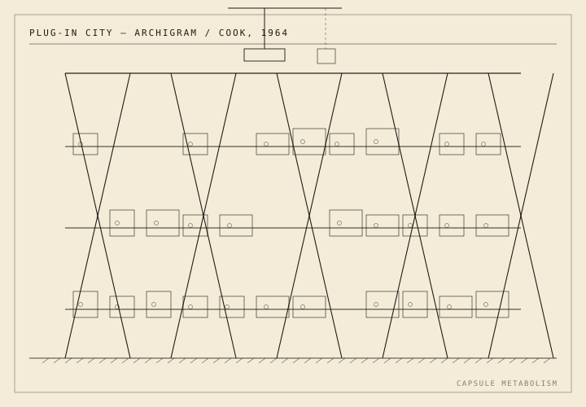

# Plug-in City

<dl class="entry-meta">
<dt>Architect</dt><dd>Peter Cook (b. 1936), of the Archigram group</dd>
<dt>Drawn</dt><dd>1964, published in Archigram 4</dd>
<dt>Intended site</dt><dd>Generic — a city typology intended for eventual application anywhere</dd>
<dt>Height / scale</dt><dd>Diagonal service-lattice megastructure 100–200 m tall; individual dwelling capsules slotted into the lattice</dd>
<dt>Status</dt><dd>unbuilt — influential on later capsule and megastructure projects</dd>
</dl>

<figure>
  
  <figcaption>Diagonal service lattice with plug-in residential and commercial capsules; a crane running on top rail</figcaption>
</figure>

## What it was

Peter Cook's Plug-in City is the clearest architectural expression of Archigram's core idea: that the city's permanent infrastructure — services, circulation, structure — should be separate from the city's temporary content — homes, shops, offices. The permanent infrastructure is a megastructure. The temporary content is a catalogue of plug-in capsules.

The megastructure in Cook's drawings is a diagonal lattice of service spines, rising to fifteen or twenty storeys, with horizontal service decks at regular intervals. The diagonal lines carry power, water, waste, data, and circulation. The horizontal decks are the loading zones into which capsules are plugged. Each capsule is a prefabricated unit — a studio apartment, a two-bedroom flat, a shop, a clinic, a classroom — manufactured in a factory and trucked to the city. Cranes running on rails atop the megastructure hoist capsules into place and, when the tenant's lease ends, remove them again.

Cook's published drawings specified depreciation periods for different parts of the city. Water and power infrastructure: forty years. Structural lattice: thirty years. Shops: five years. Dwelling capsules: fifteen years. Single-occupant rooms: three years. The city was designed from the outset to be iteratively replaced, with different lifespans for different components, on a known schedule.

The drawings circulated through Archigram magazine, through the Architectural Association's lectures, and through international publications in the mid-1960s. They appeared in the 1967 Museum of Modern Art show "Architecture without Architects" (though that show focused on vernacular; Archigram's inclusion was by contrast) and in Reyner Banham's influential 1976 book *Megastructure*.

## Why it failed

Plug-in City was not a single building proposed to a single client; it was a typology proposed to the discipline. The one mid-sized city in the 1960s that adopted pieces of the Archigram approach was Montreal, for Expo 67, where Moshe Safdie's Habitat 67 built a capsule megastructure at residential scale. Habitat 67 was partially built, stood, and is still occupied — but it is a single building, not a city, and its capsule replacement mechanism was never used.

A larger attempt was Kurokawa's Nakagin Capsule Tower in Tokyo (1972), which built the plug-in capsule idea as a single office-plus-residence building with 140 detachable capsules. The capsules were intended to be replaced every twenty-five years. None ever were. When the building's condition deteriorated irreparably, the decision in 2022 was to demolish the entire tower and preserve twenty-three of the capsules as museum objects. The replacement mechanism — the thing Archigram had designed *everything* around — turned out to be the feature no institution would actually execute.

The deeper failure mode is that buildings, once built, develop histories. Tenants furnish them, argue with them, attach memories to them. The Archigram premise that dwellings should be swapped out the way cartridges are swapped in and out of game consoles underestimated how much residents want their dwelling to be *their* dwelling, not an interchangeable unit within an upgrade schedule.

## What-if

Plug-in City's vocabulary — prefabricated modular building units, service megastructures, rapid reconfiguration — has been partially absorbed into every subsequent conversation about modular housing. The shipping-container housing movement of the 2000s is a direct descendant. Contemporary developers in China, Japan, and Sweden build residential towers from pre-cast concrete modules delivered on trucks and stacked by crane. The technology Archigram prophesied is now standard. What is missing is the swap-out — the continuous replacement that would make the city genuinely plug-in.

If a city had ever been built to Plug-in logic in full, it would be a strange thing to live in: always under construction, partly yours and partly institutionally-managed, upgraded on a schedule like a software release. It would also probably be cheaper to house people in than any city we have built. The underlying economic logic of industrial production — that unit cost falls with volume — applies to housing capsules as well as it applies to cars or phones. The reason housing costs have risen faster than other consumer goods over the past fifty years is, in part, that housing has refused industrialisation in the Plug-in sense. Archigram saw this coming. No one has taken them up on the remedy.

---

**Next:** [Continuous Monument →](continuous-monument.md)
