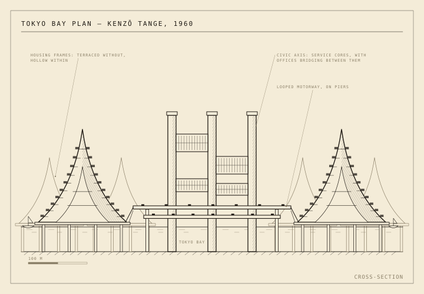

# Tokyo Bay Plan

<dl class="entry-meta">
<dt>Architect</dt><dd>Kenzō Tange (1913–2005), with his MIT graduate-student team</dd>
<dt>Designed</dt><dd>1960; presented at the World Design Conference, Tokyo, and in Tange's *A Plan for Tokyo, 1960*</dd>
<dt>Intended site</dt><dd>Tokyo Bay — a linear axis extending from the Ginza district south across the water to the Chiba peninsula</dd>
<dt>Height / scale</dt><dd>Approximately 80 km linear spine; population capacity ~10 million on branching A-frame residential units</dd>
<dt>Status</dt><dd>unbuilt — partial influence on later bay developments</dd>
</dl>

<figure>
  
  <figcaption>Central highway spine on piers, with A-frame residential megastructures branching above</figcaption>
</figure>

## What it was

In 1960 Kenzō Tange presented *A Plan for Tokyo, 1960* at the World Design Conference in Tokyo. The plan addressed what the conference had convened to discuss: the unmanageable growth of Japan's capital city, which had recovered from wartime destruction and was now expanding faster than any urban-planning framework could contain. Tokyo had historically grown by accretion around the Imperial Palace. Tange proposed it instead grow linearly, across the water of Tokyo Bay.

The plan is organised around a spine: a double ribbon of elevated highway, running on concrete piers across the bay from the existing city centre to the Chiba peninsula, approximately 80 kilometres long. At intervals along the spine, A-frame megastructures rise above the highway. Each A-frame is a lattice of residential decks, stepping inward as the frame rises to its apex. Offices, shops, and public facilities are integrated into the frames at various heights. The bay itself — the water between the piers — remains navigable; ships pass beneath the spine.

The plan is the founding document of Metabolism, the Japanese architectural movement that dominated the 1960s. Metabolism took as its premise that cities should be designed to grow and to shed cells — new residential capsules plugged in, old ones removed, infrastructure replaced in pieces — the way biological organisms grow. The Tokyo Bay Plan is the most complete expression of that idea at urban scale. Each A-frame can be extended; new A-frames can be added along the spine as the city's population grows; old sections can be demolished without affecting the whole.

Tange and his MIT-trained team (including Arata Isozaki and Kisho Kurokawa, who would go on to their own distinguished careers) worked out the scheme at a level of detail rare for a speculative project. Population projections were run; traffic models were built; concrete consumption was estimated; administrative jurisdictions were proposed.

## Why it failed

Tokyo in 1960 was governed by a plural patchwork of wards, each with its own interests, and none of them had the authority to commission an 80-kilometre megastructure across Tokyo Bay. The national government did not undertake urban-scale speculative projects on that scale; the bay was in any case being used for harbours, industry, and landfill, and the plan would have displaced these uses.

What Tokyo did instead was build piecemeal onto the bay. Starting in the 1960s and accelerating through the 1980s and 1990s, the Tokyo Bay shoreline was extended by progressive reclamation — Odaiba, the Rainbow Bridge area, and Tokyo Bay Aqua-Line, the tunnel-and-bridge crossing of the bay completed in 1997. These developments took place without the coordinating spine Tange proposed. They are additive, not planned; they are the bay made into land, rather than the bay made into a city.

## What-if

If Tokyo had adopted Tange's plan, the capital city would be a 80-kilometre line rather than a 40-kilometre disc. Transport between the northern and southern ends of the city would be fast along the spine and slow perpendicular to it. The A-frame residential blocks would have become the dominant housing type, producing a city where perhaps three-quarters of residents lived in megastructures with shared infrastructure, and the rest in traditional low-rise.

The Metabolist promise of the plan — that cells could be added and removed, that buildings could evolve — was never seriously tested at urban scale. The one Metabolist building that did get completed, Kurokawa's Nakagin Capsule Tower (1972), was demolished in 2022 because its capsules had never been swapped out as intended. The tower rusted in place and was replaced, not upgraded. This is the practical difficulty with Metabolism: the replacement mechanism requires institutional continuity that cities do not tend to provide.

Tange's later career produced built work at similar scale — the Yoyogi gymnasiums, the Tokyo Government Building in Shinjuku — none of it with the bay plan's radical geometry. The Tokyo we have is the Tokyo that grew by accretion around the Imperial Palace, with Tange's buildings distributed through it as individual nodes. The Tokyo we do not have is the line across the bay.

---

**Next:** [Fun Palace →](fun-palace.md)
