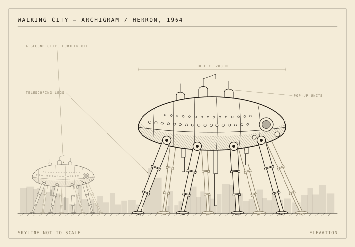

# Walking City

<dl class="entry-meta">
<dt>Architect</dt><dd>Ron Herron (1930–1994), of the Archigram group</dd>
<dt>Drawn</dt><dd>1964, published in Archigram issue 5</dd>
<dt>Intended site</dt><dd>By design, none — the city walks from place to place</dd>
<dt>Height / scale</dt><dd>Approximately 200 m long capsule bodies on telescoping legs; no specified passenger capacity</dd>
<dt>Status</dt><dd>unbuilt — intentionally provocative</dd>
</dl>

<figure>
  
  <figcaption>Two bug-like megastructures on telescoping legs, crossing a distant skyline</figcaption>
</figure>

## What it was

Archigram was a loose collective of six young British architects — Warren Chalk, Peter Cook, Dennis Crompton, David Greene, Ron Herron, Mike Webb — who met at the Architectural Association in London in the early 1960s and produced a magazine of the same name from 1961 to 1974. Archigram published drawings, manifestos, and photomontages of radical new building types: Plug-in cities, cushicles (inflatable dwellings), instant cities, urban robots. Most of it was drawn, almost none of it was built. The drawings themselves were the point.

The Walking City, by Ron Herron, appeared in Archigram 5 in 1964. The drawing shows enormous ovoid building-bodies — each perhaps 200 metres long, supported on eight telescoping legs — traversing a landscape that is identifiably somewhere between New York and the sea. The cities are insectoid, mechanical, clearly alive. Inside each body are dwellings, workplaces, recreation: the full programme of a small town, about 6,000 people. On the outer surface, rows of portholes; on the top, chimneys and communications masts; underneath, the legs, which telescope for walking and for settling.

The proposition was that the city should become mobile. A Walking City at Sydney on Monday could be in San Francisco on Friday. It could dock against another Walking City, or against a conventional city, by extending temporary bridges between hulls. It could wade offshore in a flood. It could leave a place when the resources of that place ran out. It was the opposite of every idea of a city up to that date — the settled city, the rooted city, the permanent city.

## Why it failed

The Walking City was not submitted to a planning authority and was never expected to be built. Archigram's drawings were editorial: they were meant to shake the discipline of architecture out of what the group saw as the deadening post-war compromise between modernist utopia and municipal rationalism. The drawings were themselves the output. They were shown at the Whitechapel Gallery, at the Paris Biennale, at the Museum of Modern Art. They are now in museum collections across the world.

Could a Walking City be engineered? Mechanically, yes — the telescoping-leg mechanism is tractable at reasonable scale; small mobile structures of similar principle exist (the Bagger 288 bucket-wheel excavator, the Apollo Crawler-Transporter). Nothing Herron drew violates physics. What it violates is the economic logic of buildings. A building that moves is more expensive per unit of space than a building that does not move. There is no obvious commercial market for a city that walks. The only customers would be circuses, armies, and mining companies, and each of those has settled for less ambitious solutions.

## What-if

A successful Walking City would have rewritten the idea of "home". People would live somewhere but not live *at* somewhere. The city would dock, for a week or a month, then walk to its next location. Employment, civic participation, school assignments, postal service — every institution that assumes a fixed residence would have to be reorganised around residential mobility at city scale. We do not know what such a society would look like because we have never produced it.

Archigram's larger insight — that buildings might not need to be permanent, that architecture could be considered the organisation of change rather than the creation of fixity — has had a diffuse influence on the discipline. Buckminster Fuller's Dymaxion House shares it; Yona Friedman's Spatial Cities share it; Price's Fun Palace shares it. None of these got built. The buildings that did get built since 1964 are, with rare exceptions, as permanent as buildings have always been.

The Walking City is worth revisiting now because climate-driven population movement is beginning to make mobility at urban scale a live question. Some coastal Bangladeshi villages have been moving inland at a rate of tens of metres per year. Some Alaskan villages have been relocating entirely. The form these moves take is not insectoid megastructures; it is, typically, resettlement to new concrete-and-steel buildings in safer places. The underlying phenomenon — that the built environment must sometimes migrate — is nonetheless one Archigram noticed sixty years early.

---

**Next:** [Plug-in City →](plug-in-city.md)
