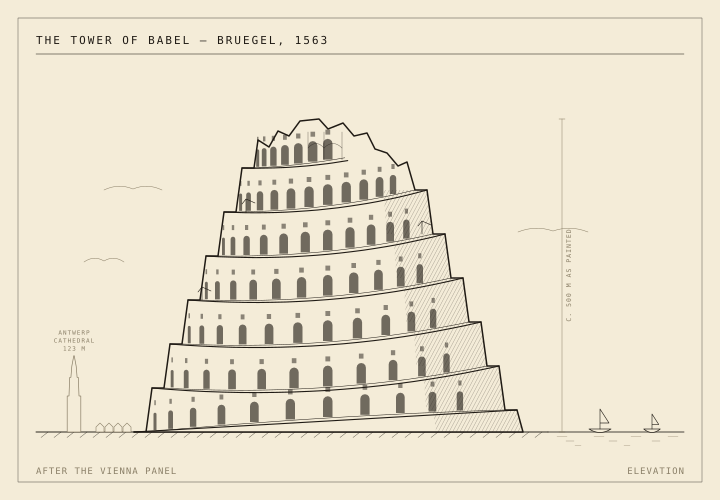

# The Tower of Babel

<dl class="entry-meta">
<dt>Architect</dt><dd>Pieter Bruegel the Elder (painter; the "architect" is the biblical Nimrod)</dd>
<dt>Painted</dt><dd>1563 (Vienna version); second version c. 1568 (Rotterdam)</dd>
<dt>Intended site</dt><dd>Shinar; Bruegel transposes it onto a harbour that reads as Antwerp</dd>
<dt>Height / scale</dt><dd>Bruegel's tower reads at approximately 500 metres — far taller than any building of 1563, or 2026</dd>
<dt>Status</dt><dd>imagined — abandoned by God</dd>
</dl>

<figure>
  
  <figcaption>Seven stepped drums, a spiral ramp, and the famously unfinished top</figcaption>
</figure>

## What it was

Genesis 11 gives the tower a single sentence of description: the people of Shinar resolved to build "a city, and a tower, whose top may reach unto heaven." Everything else — its form, its engineering, its colour, its ruin — has been supplied by painters. Bruegel's Vienna *Tower of Babel*, painted in 1563, is the painting that most people mean when they picture the building. It is the canonical Babel.

The design is a seven-drum stepped cylinder, each drum smaller than the one beneath, wrapped by a continuous spiral ramp along which tiny figures haul tiny stones. The lower drums are built in a Roman arcaded masonry recognisable from the Colosseum; the higher drums shift toward rougher fabrications. At the very top, the construction breaks down mid-air, with scaffolds and half-raised blocks. The painting is in the middle of construction forever.

Bruegel places the tower at the edge of a working port. Ships are moored at the base. Cranes are operating. In the foreground the king — Nimrod — inspects the work with his retinue while masons bow. The painter has transposed a biblical scene onto the Low Countries of his day, and the tower stands as a project that Antwerp's merchants could plausibly have commissioned if they'd had the labour and the hubris.

## Why it failed

The scriptural reason: language. God, displeased with the project's presumption, confused the tongues of the builders; they could no longer coordinate; the tower was abandoned. The reason the tower remains unbuilt in any subsequent era is structural. No masonry compression tower of the proportions Bruegel paints can stand: the load at the base would exceed the compressive strength of the stone long before the upper drums rose. The tower in the painting is already failing — the drums are visibly out of plumb, and cracks run through the lower courses. Bruegel knew this. He was painting a *ruin-in-progress*.

The choice of cloud level is itself a kind of admission. The upper drums disappear into a layer of mist. We never see the top. The building's crown is literally beyond depiction.

## What-if

If the Tower of Babel existed, it would be what Boullée's cenotaph and Tatlin's spiral attempt to be: a building whose size is the message, independent of function. The iconography of the colossal — Lenin on Iofan's base, Hitler under Speer's dome, Saddam Hussein's Victory Arch — all inherit something from Bruegel's plate, by way of every painter who copied it for four hundred years.

Bruegel's tower is also the first ruin of modernity. The building does not die from age; it dies from ambition. The stones are fresh. The cranes are still turning. The building has simply been too large to build for as long as anyone has tried to imagine such a building, and it will remain so.

---

**Next:** [Sforzinda →](sforzinda.md)
