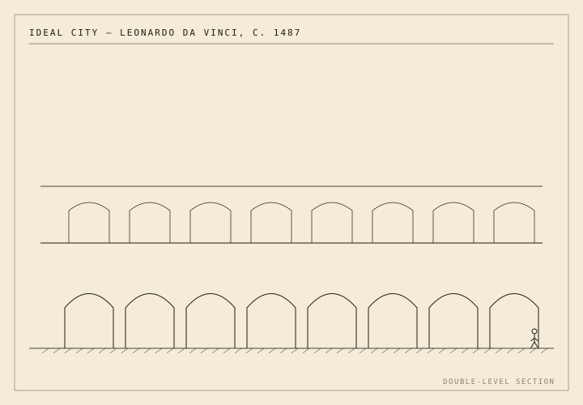

# Da Vinci's Ideal City

<dl class="entry-meta">
<dt>Architect</dt><dd>Leonardo da Vinci (1452–1519)</dd>
<dt>Designed</dt><dd>c. 1487, sketched across several folios of the Paris MS B</dd>
<dt>Intended site</dt><dd>Proposed for Milan following the plague of 1484–1485</dd>
<dt>Height / scale</dt><dd>City for approximately 30,000 inhabitants on two circulation levels</dd>
<dt>Status</dt><dd>unbuilt</dd>
</dl>

<figure>
  
  <figcaption>Two-level section: arcaded upper streets, service canal and lower streets beneath</figcaption>
</figure>

## What it was

Leonardo's ideal city does not exist as a single drawing. It appears in fragments across the folios of Paris Manuscript B — plans, sections, elevations, notes on sewage, notes on water supply, notes on loading bays. Assembled, these fragments describe a city organised on two levels.

The upper level is for the rich. It is reached by a continuous arcaded street at first-floor height and is reserved for pedestrians, for horses ridden for pleasure, and for carriages bearing gentlemen. Buildings line the upper street with their principal facades. Windows and balconies open outward to the arcade. The proportions are Vitruvian, the materials stone.

The lower level is for everyone and everything else. Beneath the arcaded street runs a deeper street for carts, for porters, for deliveries. Beneath that, in a channel cut parallel to the lower street, runs a canal. The canal takes goods in and takes waste out. The lower level is connected to the upper by stairs placed at frequent intervals, and the upper is connected to the lower by chutes through which the refuse of the houses falls directly into the canal below.

The design was Leonardo's response to the plague that killed as much as a third of Milan's population between 1484 and 1485. He blamed the disease on the filth of the existing streets — on the mixing of commerce, traffic, animals, and people in the narrow medieval lanes of the city. His solution was spatial separation: to lift the citizens up out of the muck on a clean level, and to push the muck down onto a working level beneath them.

## Why it failed

Milan did not have the money, and Ludovico Sforza — Leonardo's patron, and Francesco's son — had other wars to fight. The plan required demolishing large parts of the existing city and rebuilding on a uniform geometric grid with uniform facades. No Renaissance duke ever had that kind of authority over his own capital. Even Haussmann, who did have something approaching that authority four centuries later, could only rebuild arterial corridors through Paris, not the whole city.

There is also a social objection that Leonardo's plan raises and does not resolve. The two-level scheme makes the class hierarchy of the city into an architectural hierarchy. The rich walk over the heads of the poor, and the poor never need to appear to the rich. Later ideal cities retained the hygienic insight — separate the waste from the citizenry — without the social one. The London sewer system of the 1860s, Paris's Haussmann sewers of the 1850s, and every modern city's underground infrastructure, are Leonardo's *lower level* built without the *upper*.

## What-if

If Leonardo had been given Milan to rebuild, the model for every nineteenth-century sewer system would have been Italian rather than French or English. The social geometry of the plan would likely not have survived: cities built on class-stratified levels do not remain so for long. The canal beneath would have served as a hybrid drain-and-delivery system, with consequences for hygiene that the rest of Europe would have had to catch up to.

The lingering insight of Leonardo's plan is that infrastructure is part of architecture. A building whose service entrances, waste outlets, and delivery routes are designed into the original section is a different building from one whose infrastructure is bolted on later. Most of the modern buildings around you are the bolted-on kind. Leonardo drew, in 1487, the other kind.

---

**Next:** [Cenotaph for Newton →](../enlightenment/newton-cenotaph.md)
