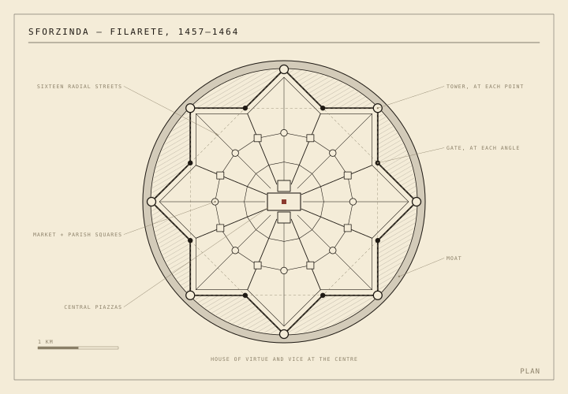

# Sforzinda

<dl class="entry-meta">
<dt>Architect</dt><dd>Antonio di Pietro Averlino, called Filarete (c. 1400 – c. 1469)</dd>
<dt>Designed</dt><dd>1457–1464, described in the *Trattato di architettura*</dd>
<dt>Intended site</dt><dd>The Duchy of Milan, at the pleasure of Francesco Sforza. Never sited.</dd>
<dt>Height / scale</dt><dd>City for approximately 100,000 inhabitants on an eight-pointed star plan inscribed in a circle of ~3.5 km diameter</dd>
<dt>Status</dt><dd>unbuilt</dd>
</dl>

<figure>
  
  <figcaption>Eight-pointed star plan with eight radial streets converging on a central piazza</figcaption>
</figure>

## What it was

Sforzinda is the first complete design for an ideal city in Western architecture. Filarete drew it for Francesco Sforza, the condottiere-turned-Duke of Milan whose name the city was to carry. The plan is an eight-pointed star — two squares rotated forty-five degrees from each other — set inside a moat. Eight radial streets run from the points of the star to a central piazza. The eight valleys between the star's points hold markets and minor squares; the eight bastions of the points hold defensive towers.

At the centre sits a complex of three piazzas: the principal square with the Duke's palace and the cathedral, and two flanking squares for the markets and for the Courts of Justice. From the central piazza rises the *Casa della Virtù e del Vizio* — the House of Virtue and Vice — a stepped tower whose lower floors contain brothels and gaming rooms and whose upper floors contain schools of music, rhetoric, and astronomy. The inhabitant of the lower floors, by climbing the tower, literally ascends from vice to virtue. Filarete's illustrations show each floor in elevation.

The treatise that describes Sforzinda is the *Trattato di architettura*, a manuscript of more than three hundred folios in dialogue form. It is a weird book. It contains Filarete's plans for the city's hospitals (radial wards for contagion control, a form the 19th century would eventually rediscover), its sewer system, its prison, and its harbour, along with astrological charts for siting the foundation stones. The whole city is set according to the positions of the planets on a specified date.

## Why it failed

Sforzinda failed because Sforza's Milan did not want a new city; it wanted to strengthen the city it had. Filarete arrived in Milan in 1451 as a builder with an existing reputation — he had cast the bronze doors of St Peter's in Rome — and Sforza employed him on the Ospedale Maggiore, which was built and survives. The ideal-city treatise was a side project, presented to the Duke as a proposal but never acted on. Sforza's interests were in strengthening the Castello Sforzesco, paying mercenary armies, and keeping the French out of Lombardy. Founding a new city from nothing for one hundred thousand inhabitants required a peace and a treasury Milan did not possess.

The specific obstacle was money. Filarete's estimate for the founding of Sforzinda runs to figures the Duchy's revenues could not service without taxing itself into revolt. The treatise implicitly assumes a patron with the resources of a monarch and the ambition of a god.

## What-if

The ideal-city tradition Filarete inaugurated — the star plan, the radial streets, the central piazza — did get built, eventually, but not for Francesco Sforza. Palmanova (founded 1593 by the Venetian Republic as a frontier fortress) is the closest realisation of Sforzinda's military geometry. The planned colonial capitals of the New World — Mannheim, Karlsruhe, L'Enfant's Washington — carried pieces of the scheme forward.

But an intact Sforzinda would have been the first *conceptually* modern city: every element situated by reason, nothing by historical accident. It would have been a Renaissance rehearsal for Brasília and Chandigarh. The uncomfortable thing about Sforzinda is that Filarete had the idea five hundred years before the tools existed to execute it, and when the tools existed, the cities we built were Brasília and Chandigarh. The inhabitants of those twentieth-century ideal cities did not, on the whole, enjoy them.

---

**Next:** [Da Vinci's Ideal City →](ideal-city.md)
